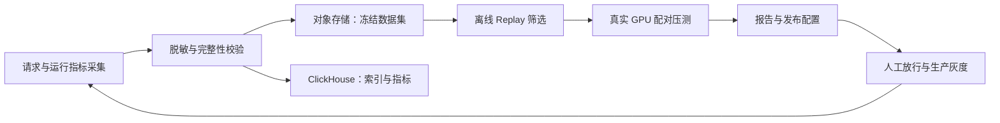

# Dynamo Replay 调优闭环实施方案

> 编制日期：2026-11-10  
> 状态：设计方案，尚未实施  
> 测试集群：`ack-LB97i2CZNR`；命名空间：`nhi`  
> kubeconfig：`/Users/lucy/Documents/Code/gitlab/nhi-data-validator/kube-config/ack-LB97i2CZNR.kubeconfig`

## 1. 目标与架构

以 `nhi/dynamo-trace-demo-mixed` 的 **Qwen2.5-7B PD 路径**为基线，建立固定 GPU 预算下的吞吐优化闭环。生产发布保留人工放行。

第一版成功标准：

- 相同模型、GPU 预算、输入数据与负载下，P95 TTFT、TPOT 相对基线回退均不超过 5%，错误率不增加。
- 满足上述约束的最大可持续吞吐提升至少 10%。
- 每次结论可追溯到数据集、镜像 digest、配置、硬件和压测原始结果。
- 相对门槛用于测试筛选；生产上线必须补齐业务绝对 SLO。

### 1.1 环境依据

2026-11-10 只读检查确认：

- `dynamo-trace-demo-mixed` 与 `dynamo-trace-demo-planner` 两套 DGD 均 Ready，使用 SGLang runtime 镜像标签 `1.4.1-amd64`。
- mixed 的 aggregated 使用 `Qwen3.8-27B / TP=4`，decode 使用 `Qwen2.5-7B-Instruct / TP=1`。不同模型不能直接作为聚合与 PD 性能对照。
- mixed Frontend 配置 HTTP 端口为 `9990`，已配置 OTel traces 导出。
- 现有 NodePort 30000 指向 planner，首版压测使用经核验的 mixed 专用入口。
- `nhi` 已有 OTel Collector 和 Vector 组件；存在组件不代表存储链路已经验证通过。

仓库当前源码与部署镜像不能直接视为同一能力版本。已有 [trace 采集草案](trace-collection-plan.md) 和 [独立采集单元设计](evidence/06-independent-trace-stack.md) 是历史参考，其环境结论需要重新核验。

## 2. 采集与存储

### 2.1 采集实现

保留现有 OTel Span 链路，用于分析 Frontend、Worker、SGLang 各阶段耗时；新增可回放请求数据通道。

- 首版在专用请求入口增加流式采集代理，保持 SSE 透传，记录请求到达、首 token、完成、取消和错误时间。
- 请求内容在持久化前脱敏；禁止保存认证头。会话标识使用稳定假名，脱敏映射在同一数据集内一致，尽量保留共享前缀关系。
- 记录模型、messages、采样参数、输入输出 token 数、实际输出长度、请求与会话 ID、到达间隔，以及数据完整性标记。
- 通过请求 ID 关联 Span、实际 Worker、GPU 指标和 KV 命中信息；无法关联的字段标记缺失，不填推测值。
- 当前源码原生 Request Trace 作为后续增强项：先验证部署镜像能力，再决定启用或升级。其 OTel sink 输出 LogRecord，需要 logs pipeline，不能直接复用 traces pipeline。
- 有界异步缓冲与采集丢失计数保护服务；发生丢失的窗口不得作为正式验收数据集。

首版支持文本 chat completion；工具调用仅回放已记录的请求历史，不执行真实工具；多模态请求独立计数并排除出首版性能结论。

### 2.2 存储与数据契约

| 产物 | 内容与用途 |
|---|---|
| `capture.jsonl.gz` | 脱敏后的请求、响应元数据、时序及关联 ID |
| `dataset-manifest.json` | schema 版本、文件 SHA-256、时间窗、模型/tokenizer 版本、脱敏版本、缺失率、采样规则 |
| 离线 trace | 从冻结数据集转换的长度、时间戳、前缀关系；记录转换版本与哈希粒度 |
| `experiment.yaml` | 基线与候选配置、GPU 预算、负载、缓存状态、门槛和随机种子 |
| `result.json` | 原始结果位置、指标、有效性判定、收益和发布资格 |

对象存储保存不可变数据集与实验产物；ClickHouse 保存数据集索引、实验摘要和关联指标，不存完整请求正文。具体连接信息由部署配置注入。

默认脱敏请求保留 7 天，指标和发布证据保留 90 天；通过配置调整。上传采用分片、校验和与幂等重试，所有对象完成校验后才发布 manifest。原始未脱敏正文不落盘。

## 3. Replay 调优与真实压测

### 3.1 基线冻结

实施前导出 DGD、实际 Pod 配置、镜像 digest、模型/tokenizer 校验信息、GPU 型号和分配情况，确认 Qwen2.5-7B 的 prefill/decode 路径与服务发现范围。

GPU 预算以实机确认的该模型资源总量冻结。基线与候选顺序占用同一组测试资源，避开其他作业干扰。不能仅凭处于 `nhi` 就认定两套 DGD 已隔离，必须验证实际请求落点。

### 3.2 数据集与负载

- 收集连续正常、峰值、突发时间窗；按时间切分调优集与独立验收集。
- 保留请求顺序、到达间隔、会话依赖和前缀局部性，不随机打乱后声称是原始流量回放。
- 对比脱敏前后长度分布和前缀复用统计；失真指标随报告展示。
- 分开执行冷缓存与预热缓存场景；预热流量不计入正式结果。

### 3.3 离线筛选

复用仓库已有 trace 转换和 DynoSim 能力，先用实测基线校准时延、吞吐和缓存行为。

首轮保持模型、TP、GPU 数及 PD 拓扑固定，逐组搜索引擎调度参数；后续再评估同预算下的聚合与 PD 拓扑。参数范围以冻结版本实际支持的参数为准。

没有目标硬件或引擎的可靠时序模型时，离线结果仅用于机制分析，不用于收益预测；直接进入小规模真实 GPU 筛选。保留最多三个候选进入正式压测。

语义不变的 replay 实现修改使用确定性 parity 验证；改变调度配置的候选允许结果不同，不要求与基线字节一致。

### 3.4 真实 GPU 验证

使用 Kubernetes Job 运行回放适配器，并复用 AIPerf 完成标准负载扫描与指标汇总。精确到达时序和会话约束由回放适配器负责。

- **保真回放：** 按原始相对时间发送脱敏请求，保留采样参数，记录实际生成长度变化。
- **容量扫描：** 使用固定数据集与统一输出长度策略，逐步提高到达速率；与保真回放分别报告。
- 基线、候选交替运行至少三对；每轮预热至少 5 分钟，正式测量至少 15 分钟且完成至少 1,000 个请求。
- 同时报告请求吞吐、输出 token/s、满足 SLO 的 goodput、TTFT/TPOT 分位数、错误、排队、GPU 利用率、KV 命中和传输指标。
- 负载发生器饱和、请求发送明显迟到、路由跨实例、数据缺失或节点干扰时，该轮作废。
- 验收收益以独立数据集为准；波动导致无法确认 10% 收益时标记“证据不足”，不发布。

## 4. 生产发布与反馈

流水线状态为：

`采集 → 数据集冻结 → 基线有效 → 候选通过 → 待人工放行 → 灰度 → 发布完成/回滚`

每个状态保存证据，失败后只重试当前阶段。

发布包包含候选配置、基线差异、镜像 digest、数据集标识、测试报告、绝对 SLO 和回滚配置。缺少生产目标、流量入口或绝对 SLO 时，停留在“待发布配置”，不自动修改生产。

人工放行后：

1. 部署候选，完成模型加载、健康检查及预热。
2. 按会话稳定分流，依次执行 5%、25%、50%、100% 灰度。
3. 每级至少观察 30 分钟并完成 1,000 个请求；对照同时间段基线，避免业务流量变化造成误判。
4. 连续两个 5 分钟窗口违反绝对 SLO 或相对退化门槛，自动切回基线；崩溃、OOM 或不可用立即回退。
5. 回退停止新流量进入候选，保留在途请求的排空时间。
6. 全量后观察 24 小时，再释放旧版本资源；新的生产 trace 成为下一轮数据集。

灰度需要额外部署容量；“固定 GPU 预算”约束候选与基线的性能比较，不代表灰度期间无需双版本资源。

## 5. 实施交付与验收

| 阶段 | 交付物 | 必须通过的验证 |
|---|---|---|
| 基线确认 | 部署快照、路径与资源清单 | 请求实际落到目标模型及 Worker，无跨实例污染 |
| 采集存储 | 代理、脱敏器、上传器、索引 | SSE、取消、错误、超长请求、上传重试；无未脱敏内容落盘 |
| 数据集构建 | manifest、转换器、质量报告 | 重复/缺失检测、时序保留、tokenizer 一致、前缀统计可追溯 |
| 调优验证 | 离线任务、GPU Job、报告生成器 | 冷热缓存、峰值突发、配对对照、无效运行拒收 |
| 发布闭环 | 发布包、灰度及回滚流程 | 未放行不能上线；注入故障触发回滚；配置和证据可追溯 |

第一版不包含 Planner 弹性优化、跨模型收益比较和自动生产审批。所有开发从跟踪 issue 开始；本文仅记录方案，不表示已实施或通过验收。

## 6. 已确认的决策与参考

| 决策 | 已确认选择 |
|---|---|
| 优化目标 | 固定 GPU 提升吞吐，以延迟和错误率为约束 |
| 采集内容 | 受控保存脱敏请求 |
| 首版基线 | mixed，生产人工放行 |
| 目标模型 | Qwen2.5-7B |
| 测试门槛 | 相对基线门槛；生产前补齐绝对 SLO |
| 存储 | ClickHouse 检索 + 对象存储保存脱敏数据集 |

仓库能力参考（实施时须与固定版本核对）：

- [Request Trace 配置与记录格式](../../docs/fern/pages/reference/observability/request-traces.mdx)
- [DynoSim 离线仿真与 trace 回放](../../docs/fern/pages/cli/operations/simulation-with-dynosim/dynosim-replay.mdx)
- [Replay parity 验证技能](../../.agents/skills/dynamo-kv-replay-parity/SKILL.md)
