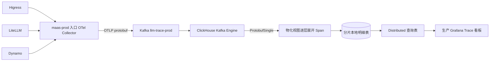

# maas-prod OTel Trace 接入生产 ClickHouse

核对日期为 2026-11-27。本手册使用 maas-dev 已实测的 Kafka Engine 直连方案。
生产 Collector 已恢复 Kafka 导出。ClickHouse 明细表、查询表、Kafka 队列和解析 MV 已在六个节点部署。
生产 Collector → Kafka → ClickHouse 已通过合成 Trace 端到端验证。
maas-dev 已通过真实请求验证 Kafka 消费、OTLP 解码、物化视图落表、位点提交和 Grafana 展示。
[maas-dev 实施记录及 SQL](../../maas-dev/README.md)



## 生产环境已核实状态

| 项目 | 2026-11-27 只读核对结果 |
|---|---|
| Kubernetes | `maas-prod`。入口 Collector 位于 `nhi/otel-collector`，1 个 Ready 副本 |
| Collector | 镜像标签 `opentelemetry-collector-contrib:0.120.0`，Trace pipeline 已从 `debug` 切回 Kafka，写入 `llm-trace-prod`，编码 `otlp_proto`，`required_acks=-1` |
| Kafka | `llm-trace-prod` 已存在，3 个分区，各 3 副本且 ISR 为 3，`min.insync.replicas=2`，`cleanup.policy=delete`，按时间保留 24 小时，`retention.bytes=-1` |
| ClickHouse HTTP | `http://10.107.159.3:31168`，已使用 `insight` 登录并执行只读 SQL |
| ClickHouse 原生接口 | `10.107.159.3:31169`，按用户提供的端点记录，尚未验证原生协议连通性 |
| ClickHouse 拓扑 | `25.4.3.22`，`cluster-storage` 为 3 分片 × 2 副本，`llm_observability` 使用 `Atomic` |
| 既有对象 | `llm_observability.llm_traces_otlp` 和 `llm_traces_otlp_all` 已存在，继续保留 |
| 新目标表 | 已执行 `01`，六个节点均存在 `_local`、`_all` 表，各分片此前核对为 `2/2` 副本活跃。`insight` 已通过 `_all` 查到合成 Span |
| Kafka 队列和 MV | 已执行 `02` 和 `03`，六个节点已挂载 `llm_traces_kafka_mv`。消费组稳定，6 个消费者中 3 个分别负责 3 个分区 |
| 权限及 schema | `isg` 的 `CREATE TABLE`、`CREATE VIEW` 和 `CLUSTER` 权限已核实。六个生产节点均已通过 `ProtobufSingle` 解码探测。`insight` 用于只读查询 |

生产 DDL 使用 `isg`，schema 文件由具备 ClickHouse 节点部署权限的人员安装。Grafana 使用具有新查询表 `SELECT` 权限的只读数据源，
凭据从现有密钥系统取用。上游路由与发送端的 Trace 开关另行核对，不从 Collector 就绪状态推断已启用采集。
[Higress 与 LiteLLM 接入说明](../integration/otel-trace-integration.md)

## 1. 准备生产对象和 schema

| 对象 | 生产名称或参数 |
|---|---|
| Kafka 消费组 | `clickhouse-maas-prod-otlp-v1` |
| Kafka 队列 | `llm_observability.llm_traces_kafka_queue` |
| 解析 MV | `llm_observability.llm_traces_kafka_mv` |
| 分片本地表 | `llm_observability.llm_traces_otlp_kafka_v1_local` |
| Grafana 查询表 | `llm_observability.llm_traces_otlp_kafka_v1_all` |
| Protobuf schema | `otel_trace_clickhouse.proto`，消息类型 `ExportTraceServiceRequest` |

用 `ON CLUSTER 'cluster-storage'` 在六个节点创建对象。本地表使用独立 Keeper 路径，
同一分片的两个副本使用该分片的路径，查询从每个分片读取一个副本。Kafka 队列和 MV 也部署在六个节点，
每节点配置一个消费者并共用同一消费组。当前只有 3 个 Kafka 分区，因此最多 3 个消费者有分区，
分配可能集中在部分 ClickHouse 分片。验收以消费组覆盖全部分区为准。
MV 直接写入所在节点的 ReplicatedMergeTree，Grafana 从 Distributed 表查询。

1. 确认 ClickHouse 节点可连接 Kafka 返回的 broker 地址，Collector Pod 也可连接 Kafka。生产 broker 列表沿用 `10.107.159.7:9092`、`10.107.159.8:9092`、`10.107.159.9:9092`、`10.107.159.10:9092`。
2. 将 dev 已验证的 `.proto` 持久化到六个 ClickHouse 节点的 `format_schema_path`，核对文件校验和、文件名和读取权限。放入现有可读路径时通常无需重启 ClickHouse 或 Kafka。若需新增 Pod 挂载，按 ClickHouse 维护流程滚动生效。 [已验证的 schema](../../maas-dev/clickhouse-kafka/otel_trace_clickhouse.proto)
3. 用具备相应权限的账号逐节点执行下方的合成 protobuf 读测。六个节点均应返回 `resource_batches=1`。随后用队列完整列定义、MV 的 SELECT 及一条脱敏合成 Trace 验证实际 Span 展开。HTTP NodePort 可能负载均衡，应记录 `hostName()`，逐节点确认结果。

```sql
SELECT hostName(), length(resource_spans) AS resource_batches
FROM format('ProtobufSingle', 'resource_spans Array(Tuple(schema_url String))', unhex('0a031a0178'))
SETTINGS format_schema = 'otel_trace_clickhouse:ExportTraceServiceRequest';
```

## 2. 从已验证 SQL 生成生产 DDL

在仓库根目录运行以下脚本。它仅生成文件。生产和测试使用相同表名，各自连接独立 ClickHouse，Topic、消费组和 `cluster_id` 区分环境。
结果沿用 `ProtobufSingle`、逐层 `ARRAY JOIN`、ID 小写十六进制和纳秒时间戳，保存 Kafka 分区、位点和消息内 Span 序号。
明细表初始按入库时间保留 **7 天**。这是上线初始建议，延长 TTL 前先评估写入量和磁盘预算。

```bash
python3 - <<'PY'
from pathlib import Path

src = Path('learning/full-otel-trace/maas-dev/clickhouse-kafka')
dst = Path('learning/full-otel-trace/maas-prod/clickhouse-kafka/generated-sql')
dst.mkdir(exist_ok=True)
replacements = {
    'llm-trace-dev': 'llm-trace-prod',
    'clickhouse-maas-dev-otlp-v1': 'clickhouse-maas-prod-otlp-v1',
    "'maas-dev'": "'maas-prod'",
    '/{shard}/llm_traces_otlp_kafka_v1_local': '/{shard}/llm_traces_otlp_prod_kafka_v1_local',
}
for name in ('01-target-tables.sql', '02-kafka-queue.sql', '03-materialized-view.sql'):
    sql = (src / name).read_text()
    for old, new in replacements.items():
        sql = sql.replace(old, new)
    assert not any(old in sql for old in replacements), name
    (dst / name).write_text(sql)
    print(dst / name)
PY
```

DBA 评审 DDL 中的目标集群、Keeper 路径、账号授权和对象名。当前生产已执行 `01`、`02` 和 `03`，复核既有定义即可。
明细表更名时保留了原 Keeper 路径，生成脚本也保留该路径以匹配生产现状。
挂载前复核六个节点的队列定义和 schema，验证后执行 `03` 启动消费。
既有 `llm_traces_otlp`、`llm_traces_otlp_all` 与新表独立。
`02` 保留 `kafka_skip_broken_messages=0`，解析错误使所在批次失败，可从 `system.kafka_consumers` 排查。
ClickHouse 写入与 Kafka 位点提交之间可能发生重放，统计按 `(cluster_id, trace_id, span_id)` 去重。
[Kafka Engine 的配置与虚拟列](https://clickhouse.com/docs/reference/engines/table-engines/integrations/kafka)

挂载 MV 前检查新消费组状态。首轮试运行建议从上线检查点开始消费，避免自动回放已有历史批次。
需要对新组预置位点时，仅在组无活跃成员时对 `llm-trace-prod` 操作，记录各分区起始位点。
若选择回放，从仍在保留窗口内的位点起读。Kafka receiver 的 `initial_offset` 不能用作 Kafka Engine 表设置。
本次启动前分区 `0` 仅有一条历史探测消息，新组使用默认起始策略，验证时已将该消息和新探测消息写入明细表。

## 3. 恢复生产 Collector 的 Kafka 导出

此步骤已于 2026-11-27 执行。Collector 滚动更新完成后，合成 Trace `0ffa8404973b8db5e2a8383f70e25873`
从 OTLP/gRPC 成功写入 `llm-trace-prod` 的分区 `0`、位点 `0`。以下保留复现与回退所需步骤。

先将生产 `nhi/otel-collector-config` 和 Deployment 导出做回退备份。所有 Kubernetes 操作显式切换并固定生产 context。

```bash
kprod() {
  kubectl config use-context maas-prod >/dev/null && kubectl --context maas-prod "$@"
}

backup_dir=$(mktemp -d -t maas-prod-otel-backup.XXXXXX)
kprod -n nhi get configmap otel-collector-config -o yaml > "$backup_dir/configmap.yaml"
kprod -n nhi get deployment otel-collector -o yaml > "$backup_dir/deployment.yaml"
printf '%s\n' "$backup_dir"
```

在当前配置中合并以下片段，保留 `otlp` 接收器及既有 processor 配置。Kafka exporter 显式固定 `otlp_proto`。
建议生产使用 `required_acks: -1`，上线前确认 ISR 满足 `min.insync.replicas=2`。现有发送队列是内存队列，
从 Kafka 已确认写入开始才能依赖 Kafka 的保留窗口，Collector 重启前还未导出的批次有丢失风险。
[Collector 本地配置](../collector/otel-collector-config.yaml) · [Kafka exporter v0.120.0](https://github.com/open-telemetry/opentelemetry-collector-contrib/tree/v0.120.0/exporter/kafkaexporter)

```yaml
exporters:
  kafka:
    brokers:
      - "10.107.159.7:9092"
      - "10.107.159.8:9092"
      - "10.107.159.9:9092"
      - "10.107.159.10:9092"
    protocol_version: "3.0.0"
    topic: llm-trace-prod
    encoding: otlp_proto
    producer:
      required_acks: -1
    timeout: 5s
    retry_on_failure:
      enabled: true
      initial_interval: 5s
      max_interval: 30s
      max_elapsed_time: 300s
    sending_queue:
      enabled: true
      num_consumers: 10
      queue_size: 1000

service:
  pipelines:
    traces:
      receivers: [otlp]
      processors: [memory_limiter, k8sattributes, transform, batch]
      exporters: [kafka]
```

先验证 Collector 配置，更新 ConfigMap 后滚动重启 Collector Deployment，并检查新 Pod 的 Ready、OTLP 监听、
启动日志和 Kafka 发送指标。首轮只开启已经授权的测试路由和对应 LiteLLM callback，带已知 W3C `traceparent`
发送一条请求。确认 Kafka 与 ClickHouse 正常后，再按路由白名单和采样策略分批扩大。

```bash
kprod -n nhi rollout restart deployment/otel-collector
kprod -n nhi rollout status deployment/otel-collector --timeout=120s
```

### LiteLLM 路由白名单与采样

LiteLLM `1.85.0` 的原生 `litellm_settings.callbacks: [otel]` 在实例范围内生效。检查了镜像中的
callback 和请求入口实现，未发现按 HTTP 路径、Higress 路由名或模型名启用该 callback 的原生白名单。
`OTEL_PYTHON_EXCLUDED_URLS` 可以影响 Python HTTP 自动插桩，实际测试中仍会产生 LiteLLM callback Span。
属性 include/exclude 配置也只决定 Span 上保留哪些字段。
[LiteLLM OTel v1 配置](https://docs.litellm.ai/docs/observability/opentelemetry_integration)

在 `maas-dev/litellm-system` 用与现有代理相同的 `v1.85.0-e610b07` 镜像启动了隔离 Pod，
请求同一个 mock 模型，并从 `llm-trace-dev` 按准确 Trace ID 核对新消息。
探针设置了 `OTEL_TRACES_SAMPLER=parentbased_always_off`，并通过 `OTEL_PYTHON_EXCLUDED_URLS`
排除 `/chat/completions` 路径，同时保留 `/v1/chat/completions`。

| 测试路径 | `traceparent` 采样标记 | HTTP | 导出 LiteLLM Span |
|---|---|---|---|
| `/v1/chat/completions` | `01` | 200 | 7 |
| `/chat/completions` | `01` | 200 | 7 |
| `/v1/chat/completions` | `00` | 200 | 0 |
| `/chat/completions` | `00` | 200 | 0 |
| `/v1/chat/completions` | 无 `traceparent` | 200 | 0 |

生产可先评估**上游控制采样**。Higress 在白名单路由生成并向 LiteLLM 转发有效的已采样 `traceparent`，
其他路由向 LiteLLM 转发未采样上下文或不传父上下文。LiteLLM 启用原生 callback 并设为
`parentbased_always_off`，由可信的上游采样结果决定出站 Span。入口白名单验收必须覆盖外部调用者
自行提供 `traceparent` 且标记为 `01` 的情况，确认非白名单路由无法借此外传 Span。
同时限制绕过 Higress 直接访问该 LiteLLM 实例的来源。

上面的测试从 LiteLLM 直接入口开始，只验证代理遵循采样标记，还没有验证生产 Higress 如何生成、
清理和转发这些标记。生产正式代理镜像标签为 `v1.85.0-dc363b68`，正式启用前应在目标镜像上再验证。
如果业务要求无论传播标记如何，都只允许指定路由上报，使用独立 LiteLLM 实例并只将白名单路由指向它。
Collector 过滤可作为兜底，但只在 Span 已生成之后减少出站及存储量，逐 Span 过滤还可能留下断链。

### 降低 LiteLLM 的追踪开销

优先在 Higress 对白名单路由做低比例头采样，LiteLLM 保持 `parentbased_always_off` 跟随上游。
这样以整条请求为采样单位，保留下来的 Trace 仍可查看完整的父子关系。若 LiteLLM 也接收直连流量，
可以用 `parentbased_traceidratio` 加 `OTEL_TRACES_SAMPLER_ARG=0.05` 对无父上下文请求抽样。
已采样的父上下文仍会被跟随，因此来自 Higress 的流量需要在 Higress 降采样比例。`0.05` 是压测起点。
抽样减少记录及导出，LiteLLM 的 callback 仍会进入请求处理流程。 [OTel SDK 采样配置](https://opentelemetry.io/docs/languages/sdk-configuration/general/)

保留 `OTEL_INSTRUMENTATION_GENAI_CAPTURE_MESSAGE_CONTENT=NO_CONTENT`，优先缩减请求正文和长属性。
已在 maas-dev 镜像的 Python SDK `1.28.0` 验证 `OTEL_SPAN_ATTRIBUTE_VALUE_LENGTH_LIMIT=512`
能生效。它适合做压测对照，启用前核对状态、路由、模型和关联 ID 等字段。继续保留独立 Prometheus 指标，
用全量指标判断错误率、TTFT 和 P95/P99，用 Trace 定位单次请求。低流量或稀有错误场景应按样本数量调高采样率。
[OTel Span Limits](https://opentelemetry.io/docs/specs/otel/configuration/sdk-environment-variables/#span-limits)

当前镜像的原生 OTLP exporter 已使用 `BatchSpanProcessor`。保持异步批量发送，观察 LiteLLM CPU、内存、
导出失败和采样后 Span 数；若出口 RPC 过多再调整 `OTEL_BSP_*`。队列过大增加内存，队列过小会丢 Span。
最后再考虑 Collector 尾采样，按错误、慢请求和普通请求决定保留比例。尾采样减少 Kafka 与 ClickHouse 的数据量，
接收侧仍承担 Span 生成、传输和缓冲，已被头采样丢弃的 Trace 也无法恢复。
[OTel 采样指南](https://opentelemetry.io/docs/concepts/sampling/)

## 4. 验收和 Grafana

已完成一次生产合成 Trace 验收。从 `nhi/otel-collector` OTLP/gRPC 发送 Trace `6b549eafe37be8ec656458c26959cb8e`，
Kafka 的分区 `0`、位点 `1` 收到 2 个 Span。用 `insight` 查询明细结果，父子关系、纳秒时间戳和位点均一致，
Kafka 消费组提交到下一个位点 `2`，落点分片两个副本均有这 2 个 Span。验收时 `system.kafka_consumers` 未见异常。
生产 Grafana 已部署 [maas-prod OTel Trace Explorer](http://isg.fed.zhejianglab.org/grafana/d/maas-prod-otel-traces/maas-prod-7c-otel-trace-explorer)。
看板绑定专用数据源 `maas-prod-clickhouse-traces-http`，通过生产 HTTP 接口使用只读账号 `insight`。
Grafana 插件 4.5.1 的客户端会在查询超时大于 1 秒时尝试设置 `max_execution_time`，该操作受 `insight` 只读设置限制。
专用数据源将 Query Timeout 设为 1 秒，允许保留现有账号权限。遇到宽时间范围超时，可以先缩小时间范围。
如需提高超时，由 DBA 为专用只读账号配置允许修改该单项的约束。
[Grafana ClickHouse 只读账号配置](https://grafana.com/docs/plugins/grafana-clickhouse-datasource/latest/configure/#clickhouse-user-and-permissions)
用该合成 Trace 验证了 Trace 搜索、2 个 Waterfall Span 和 1 条从左到右的 Call Map 连线。
[生产看板 JSON](../grafana/grafana-otel-traces.json)

以下步骤供真实 Higress/LiteLLM 请求验收和复部署使用。

1. 应用请求成功。用已知 Trace ID 在 `llm-trace-prod` 的新消息中确认 Higress、LiteLLM 的 OTLP Span。用独立只读检查方式读取 Kafka，保留正式消费组的位点。
2. 生产消费组处于稳定状态，覆盖 `0`、`1`、`2` 三个分区。确认测试消息对应的已提交位点大于消息位点。结合 `system.kafka_consumers` 检查分配和异常。
3. 在查询表中对照测试消息的 `kafka_partition`、`kafka_offset`、Span ID 和父 Span ID。LiteLLM 入口的 `parent_span_id` 应等于 Higress 出站 Span 的 `span_id`。
4. 基于 dev JSON 建独立的生产看板，选择生产 ClickHouse 只读数据源，所有面板表名替换为 `llm_traces_otlp_kafka_v1_all`，`cluster_id` 过滤值替换为 `maas-prod`，使用独立 UID。检查 Trace 搜索、Waterfall、从左到右的 Call Map。测试路由若携带 `guid:x-request-id`，再从访问日志的 `request_id` 验证反查。
   [maas-dev 看板模板](../../maas-dev/grafana/grafana-otel-traces.json)

```sql
SELECT hostName(), consumer_id, assignments.partition_id, assignments.current_offset,
       num_messages_read, num_commits, exceptions.text
FROM clusterAllReplicas('cluster-storage', system.kafka_consumers)
WHERE database = 'llm_observability' AND table = 'llm_traces_kafka_queue';

SELECT service_name, name, trace_id, span_id, parent_span_id, start_time, duration_ms,
       kafka_partition, kafka_offset, is_valid
FROM llm_observability.llm_traces_otlp_kafka_v1_all
WHERE cluster_id = 'maas-prod' AND trace_id = 'REPLACE_WITH_NEW_TRACE_ID'
ORDER BY start_time, span_id;
```

运行期关注 Collector 发送失败与队列占用、Kafka Lag 和最老未消费消息年龄、ClickHouse 插入失败及 parts/merge，
以及 `is_valid=0`、重复 Span 和 Grafana 查询延迟。告警应留足 24 小时保留窗口内的修复余量。

## 5. 回退

- **ClickHouse 解析或落表异常**：卸载 `llm_traces_kafka_mv`，确认六个节点均无该队列的活动分区，保留新队列、明细表和消费组位点。Kafka 健康时继续接收 Collector 的数据，修复后按保留窗口内的位点补消费。
- **Collector 发送影响业务或 Kafka 异常**：用备份恢复 `debug` 导出并滚动重启，再核对入口实例就绪；按变更范围回退测试路由或 callback。
- **Grafana 查询异常**：恢复生产看板上一个版本或停用新看板。保留 ClickHouse 明细用于定位。

真实请求验证完成后记录 Trace ID、Kafka 位点、DDL 版本、配置备份和实际容量。
生产入口 Collector 到 Grafana 的合成请求已验收，业务请求尚待验收。
