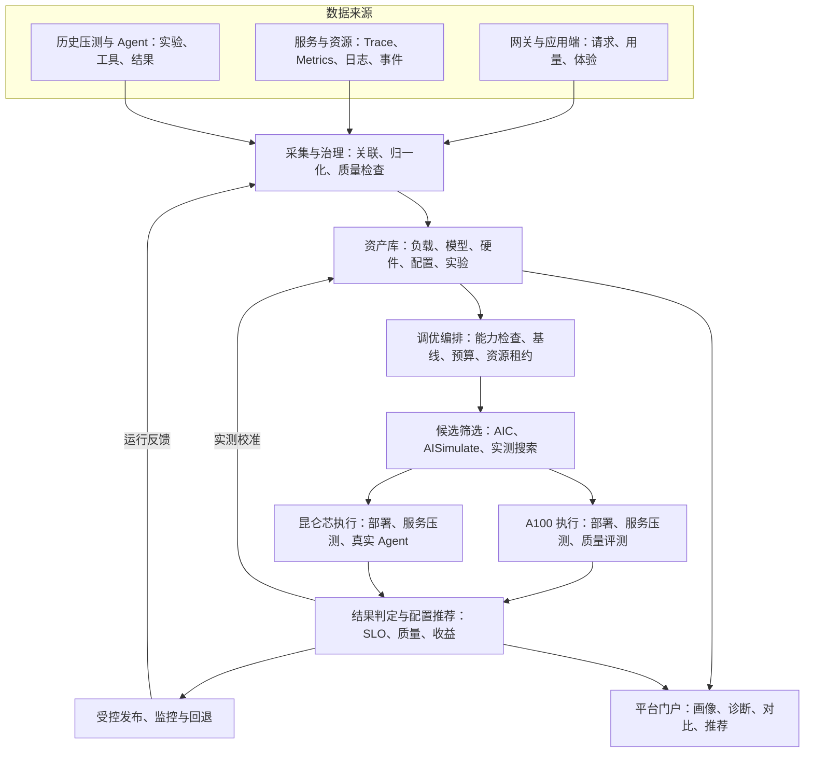

# 异构算力模型服务自动调优平台设计与实施方案

版本：V0.1 讨论稿
编制日期：2026 年 11 月 4 日
适用对象：实验室模型服务平台、推理性能、数据评测、基础设施及业务团队

建设面向交互体验与长程 Agent 任务的异构算力模型服务自动调优平台。首期以 A100 上的 236B Reason、236B Chat，以及昆仑芯上的 DeepSeek-V4.1-Flash 三个组合验证完整闭环：真实业务数据形成版本化工作负载，通过性能估算与仿真减少候选，再由真实硬件和业务评测确定可发布配置。

本期交付包括数据底座、实验管理、两类硬件适配、三组业务验证、配置推荐及受控发布。工程量基准估算为 80–120 人日，增加 20% 缓冲后约 96–144 人日；在既有基础设施和模型后端可用的条件下，计划周期为 10–12 周。昆仑芯底层模型、算子及通信栈适配另行评估。

## 1 建设目标与范围

平台需要回答：指定模型、硬件和业务目标应采用什么配置；当前配置能承载多少业务量、瓶颈在哪里；优化是否真实改善业务结果，以及如何发布和回退。

| 编号 | 硬件与模型 | 业务目标 | 首期成果 |
|---|---|---|---|
| A1 | A100＋236B Reason，准确版本待确认 | 推理交互体验 | 延迟达标的配置、容量曲线和质量报告 |
| A2 | A100＋236B Chat，准确版本待确认 | 对话交互体验 | TTFT、TPOT 达标的配置和稳定承载能力 |
| B1 | 昆仑芯＋DeepSeek-V4.1-Flash，卡型及版本待确认 | Coding 与 Agentic 长程任务 | 可运行服务、真实任务评测和优化配置 |

远期覆盖至少三类加速卡、五个模型、三类场景，形成至少 45 个基础评估单元。首期只验收上表三个组合，离线蒸馏、第三类卡及更多模型后续扩展。

首期以服务配置调优为主。模型替换、精度变化和 Agent 策略变化分别建立实验组并增加质量验证；混合卡型构成单个并行推理实例不纳入首期。默认单个部署使用同类加速卡，平台在不同资源池之间选址。

## 2 设计原则与业务指标

以真实业务数据驱动实验，以真实硬件和任务结果决定发布。预测能力缺失时允许进入有预算的实测搜索；数据库没有数据不代表部署不可行。每项推荐都必须关联版本、负载、环境、原始结果和适用范围。

| 场景 | 优化目标 | 约束与辅助指标 |
|---|---|---|
| A100 在线体验 | 固定资源上最大化可持续请求率 | p95 TTFT、p95 TPOT、成功率和质量达标；报告 p99、逐 Token 停顿及联合达标率 |
| 昆仑芯 Coding 与 Agentic | 提高预算内任务成功率，降低时间与资源消耗 | 测试通过率、超时率、完成时间、全部尝试卡时除以成功任务数 |
| 后续离线蒸馏 | 提高合格产出吞吐 | 合格样本每小时、有效输出 Token 每秒、完整性与质量 |

TTFT 必须声明测量位置和首 Token 类型：网关首响应、客户端首 Token、用户可见内容、Reason 首个最终答案分别记录。TPOT 通常按单请求首末输出 Token 间隔除以输出 Token 数减一计算；输出不足两个 Token 时标记不适用。逐 Token 间隔尾部另行统计，避免平均值掩盖停顿。

Reason 与 Chat 分别冻结负载、质量门槛和采样条件。推理预算变化作为独立变量，不通过减少推理或输出长度制造性能收益。不同 tokenizer 的 Token 吞吐不能直接作为跨模型业务效率排名。

Agent 同时记录成功任务耗时和失败、超时比例；所有尝试的资源消耗均计入成本。质量阈值、SLO 和收益目标在基线阶段由业务与平台团队共同冻结。

## 3 整体架构

控制面统一管理数据、任务、预算和结果；执行面通过硬件与后端适配器部署和评测。采集、存储和监控优先复用实验室现有设施。

推理服务与评测客户端分别部署，避免客户端成为瓶颈。不同实验仅在服务设备、端点及关键共享资源互不干扰时并行执行。

## 4 前置工作与数据底座

| 数据域 | 首期内容 | 平台产物 |
|---|---|---|
| 网关与应用 | 到达时间、项目、场景、模型、输入输出长度、usage、重试、取消、用户端时间 | 业务画像与容量需求 |
| 服务组件 | 排队、调度、Prefill、Decode、KV 传输、缓存、错误 | 请求诊断与性能瓶颈 |
| 硬件与集群 | 卡型、显存、拓扑、CPU、网络、设备错误、资源分配 | 资源目录与环境快照 |
| 配置及事件 | 权重、tokenizer、镜像、后端、驱动、生效参数、发布、扩缩容、重启 | 配置谱系及变更时间线 |
| 历史压测 | 原始结果、环境、负载、预热、缓存、错误、客户端配置 | 分级实验目录和基线 |
| Agent | 任务、会话、调用依赖、工具、仓库快照、测试判定和总消耗 | 任务评测集与执行轨迹 |
| 校准 | 预测值、实测值、预测器与数据库版本、支持范围 | 预测可信度记录 |

### 4.1 统一关联与统计口径

业务使用 project_id、scenario_id、task_id、session_id；请求使用 request_id、attempt_id、trace_id；环境使用 deployment_id、config_hash、model_revision、image_digest；实验使用 experiment_id、run_id、candidate_id、dataset_version。

一次业务请求可能对应多次后端尝试。业务成功率按请求统计，资源消耗按所有尝试累计。输入、输出、缓存、reasoning Token 保留原始字段及归一化规则，避免重复相加；缺失 usage 标记未知而非零。拒绝请求也进入请求总量，不能只用用量日志计算成功率。[LiteLLM 请求与用量统计参考](https://docs.litellm.ai/docs/proxy/endpoint_activity)

高基数标识保存于 Trace 和明细表，不全部作为 Metrics 标签。分位数从可合并分布或原始记录计算，不平均不同实例的 p95。[Prometheus 埋点实践](https://prometheus.io/docs/practices/instrumentation/)

### 4.2 采集与质量控制

- 完整记录请求计数、错误计数和可获得的用量，定期对账。
- 生产 Trace 按策略采样，保留采样配置；慢请求偏置样本不直接用于总体分位数。
- 实验请求在预算允许时完整记录，底层 profiling 和详细 Token 时间序列按需开启。
- 跨节点校时，进程内耗时采用单调时钟；检查时间偏移、关联缺失、重复、延迟和丢失。
- 采集系统提供自身队列、失败、丢弃、存储增长及开销监控。
- 原始正文与元数据分开保存，执行访问控制、脱敏、保留和删除规则；禁止采集认证凭据。
- 明确可观测能力：直接测量、推导、不可用。昆仑芯缺失指标保持未知，不以零代替。

[OpenTelemetry 采样说明](https://opentelemetry.io/docs/concepts/sampling/)提供采样机制参考。A100 可接入 [DCGM Exporter](https://docs.nvidia.com/datacenter/dcgm/latest/reference/dcgm-exporter-metrics.html)，昆仑芯使用实际可用的厂商采集器并建立字段映射。

### 4.3 历史数据与工作负载加工

历史压测分为 A 级可复现、B 级部分可比、C 级仅供参考。A 级需具备环境、负载、配置和原始结果；B/C 级不得直接进入自动排名或高置信校准。

真实数据按模型、场景和业务周期分组，重建会话与依赖，再按长度、突发、缓存复用等特征分层抽样。数据集保留到达过程、输入输出长度、前缀关系、工具等待和请求依赖，不随机打散 Agent 链路。脱敏或重新分词后复核负载分布变化。

分别维护搜索集、校准集和独立验收集。工作负载包至少包括数据文件、版本、来源时间窗、采样规则、长度与到达分布、依赖结构、校验摘要和可用回放方式。

## 5 核心模块与接口

| 模块 | 实现职责 | 首期交付 |
|---|---|---|
| 资源与模型注册表 | 硬件、模型、后端、版本、能力声明 | 管理 API 与集群同步 |
| 采集与治理 | 关联、归一化、去重、质量、内容管理 | 采集适配器和质量看板 |
| 工作负载中心 | 画像、会话重建、分层采样、版本化 | 数据集目录与导出工具 |
| 实验中心 | 基线、候选、原始产物、指标、可比性 | 实验记录与对比 API |
| 调优编排器 | 状态、超时、重试、预算、取消、恢复 | 工作流与资源租约 |
| 预测适配器 | 合法性检查、估算、仿真、排序 | AIC/AISimulate 及实测搜索接口 |
| 执行适配器 | 部署、健康、配置生效、测试、清理 | A100 与昆仑芯独立实现 |
| 业务评价器 | SLO、质量、容量、成功率、消耗 | 服务和 Agent 评价规则 |
| 配置发布中心 | 推荐、适用范围、灰度、回退 | 对接现有发布系统 |
| 平台门户 | 画像、诊断、实验、推荐与证据 | 五类核心页面 |

建议公共对象包括 ExperimentSpec、CandidateSpec、RunRecord、EvaluationResult、Recipe。对象具有 schema_version；引用不可变版本与校验摘要，不依赖可变 latest 标签。

适配器接口包括 capabilities、validate、estimate、render、deploy、health_check、benchmark、collect 和 cleanup。允许不实现 estimate，但必须声明能力。部署入口不以是否使用 Dynamo 为前提；DynamoGraphDeployment 与厂商部署模板由对应适配器生成。

建议平台 API 覆盖注册表查询、数据集发布、实验创建与取消、实验状态与结果、候选比较、配置推荐与发布。每次实际执行使用独立 run_id，幂等重试不能覆盖已有原始结果。

技术选型优先复用既有任务系统、监控和日志链路。关系数据库保存状态与索引，对象存储保存原始产物和数据集；请求明细量超过现有数据库能力后再引入专用分析存储。首期不要求新建完整监控产品。

## 6 AIC 和仿真的使用方式

| 能力 | 定位 | 决策边界 |
|---|---|---|
| AIC / AIConfigurator | 性能、显存和配置搜索 | 确认硬件、模型、后端及数据覆盖 |
| AISimulate | 配置搜索与请求回放等能力 | 按版本核实支持的后端、拓扑和模式 |
| SGLang Simulator | 分析 SGLang 调度与缓存机制 | 仅作为适合问题的专用分支 |
| AIPerf | 真实服务负载与性能测量 | 不代替模型或任务质量判定 |
| Agent 评价器 | 真实工具执行和任务结果 | 固定任务、环境与预算 |
| Dynamo Planner | 运行期资源调整 | 在已验证边界内运行，策略单独评测 |

AIC 与 AISimulate 存在演进和迁移关系。适配器固定镜像、依赖、性能数据库和接口版本，不假设不同代际可以直接混用。[AISimulate 官方仓库](https://github.com/ai-dynamo/aisimulate)

SGLang Simulator 不作为全部候选的必经阶段；目标版本的并行、overlap 等限制应进入能力声明。共享同一预测来源的两个工具结果一致，不构成独立准确性验证。[指定版本 SGLang Simulator](https://github.com/sgl-project/sglang/blob/3f5b1bec8e00115bc8439b5b9a9da902822d2f82/tools/sglang-simulator/README.md)

校准记录同时检查数值误差、候选排序和优胜候选是否被遗漏。筛选时保留预测优胜、结构差异和高不确定性候选。端到端历史压测只能支持其覆盖范围内的校准，不能直接替代完整算子数据库。

## 7 A100 交互体验路线

Reason 和 Chat 分别建立负载、质量基线和配置推荐。Reason 重点覆盖长输出、长上下文及长短请求竞争；Chat 重点覆盖多轮、前缀复用、短请求和突发。

实施顺序为：确认可运行精度与并行结构，建立真实基线，生成候选，估算与仿真筛选，A100 实测，质量与 SLO 判定，独立确认及发布。

参数搜索依次覆盖：

1. 卡数、并行方式、实例数等部署结构。
2. 批处理 Token 预算、最大并发、chunked prefill、KV 配额、前缀缓存。
3. 基础配置稳定后再评估 PD 分离、路由和 Planner 策略。

236B 参数量不足以确定卡数，应根据权重精度、模型结构、KV 缓存、上下文和互联评估；MoE 激活参数不等于权重显存占用。

每个模型交付部署配置与备选、请求率—TTFT—TPOT 曲线、SLO 下稳定请求率、正常/突发/长上下文范围、质量结果和收益证据。[AIPerf 原始结果与汇总导出](https://github.com/ai-dynamo/aiperf/blob/main/docs/tutorials/working-with-profile-exports.md)作为实验产物参考。

## 8 昆仑芯 Coding 与 Agentic 路线

第一阶段执行运行资格检查，确认指定卡型、后端、权重与精度能够加载并正确输出，验证流式、长上下文、停止条件、reasoning 字段、工具调用模板、多卡稳定性及监控。

FastDeploy 公开列出昆仑芯支持，但不据此认定指定模型与卡型组合已完成适配。项目必须取得实际运行证据。[FastDeploy 官方仓库](https://github.com/PaddlePaddle/FastDeploy)；[DeepSeek-V4.1-Flash 模型仓库](https://huggingface.co/deepseek-ai/DeepSeek-V4.1-Flash)

第二阶段建设固定 Agent、任务集、仓库快照、工具链和测试判定的执行环境。保存最终代码产物、测试结果、轮数、重试、上下文增长和终止原因，拆分模型等待、工具执行和环境等待。

第三阶段进行服务配置调优。缺少可靠预测时，采用有预算的实测搜索，逐步建立局部性能模型。不能以 A100 数据预测昆仑芯，也不能默认其他后端调度仿真在目标后端成立。

保留固定 Trace 回放和真实 Agent 执行两条路径。前者用于快速比较服务性能，后者决定任务收益；Trace 回放不重新执行工具或模型决策。[Dynamo Agent Simulation](https://github.com/ai-dynamo/dynamo/blob/main/docs/fern/pages/use-cases/agents/agent-simulation.mdx)

首期固定 Agent 策略，服务调优稳定后再单独评估压缩、重试和子 Agent 并发。真实任务执行使用隔离环境与明确的工具权限。数据集、实验、Trace、评分的展示组织可参考 [Langfuse](https://langfuse.com/docs/evaluation/get-started/offline)，实际执行和测试判定由本平台负责。

## 9 调优流程与运行控制

| 阶段 | 动作 | 通过条件 |
|---|---|---|
| 输入检查 | 版本、负载、目标、硬件与预算校验 | 输入完整，支持能力明确 |
| 基线建立 | 部署、健康、质量与性能实测 | 基线有效 |
| 候选生成 | 允许范围内生成配置变化 | 参数合法、资源可行 |
| 估算仿真 | 预测、回放、排序 | 有结果和范围，或明确跳过理由 |
| 真实验证 | 资源预留、部署、压测、业务评测 | 原始数据完整 |
| 结果判定 | 审计、质量、SLO、可比性、收益 | 满足门槛且收益具有证据 |
| 独立确认 | 保留负载、配对复测 | 结果可重复 |
| 推荐发布 | 配置库、灰度、监控和回退 | 符合发布策略 |

状态机包含待执行、校验中、建立基线、生成候选、仿真、真实实验、分析、推荐、发布及完成。失败细分为基础设施失败、配置不可行、质量不达标、数据无效和预算耗尽；另有取消状态。跳过预测保留原因，不能伪造仿真成功。

首期使用规则约束、有限搜索和预测排序。临近测量噪声的收益采用配对复测，最终候选独立确认。明确不具收益时可结束任务并输出证据，不强制产生所谓最佳改进。

资源租约按硬件与拓扑申请，多节点部署联合预留；启动、加载、预热、等待、测量、重试和释放均计入预算。取消或失败触发清理，保留产物。停止条件包括预算耗尽、达到目标、连续有效候选无收益或不可自动恢复依赖。

配置推荐通过确定性规则审核。AI 可辅助诊断和提出候选，不绕过质量与发布门槛。

## 10 平台展示与发布机制

| 页面 | 使用者可以完成的工作 |
|---|---|
| 业务需求总览 | 查询调用量、Token、峰值、分布与 SLO |
| 请求与任务诊断 | 从异常请求或任务定位 Trace、日志、资源和变更 |
| 工作负载中心 | 检查覆盖、发布数据集、导出回放包 |
| 实验与调优中心 | 设置目标和预算、运行实验、比较候选 |
| 推荐配置中心 | 查看适用范围、预测/实测、证据、发布与回退 |

操作流程为选择模型场景、资源池和负载版本，设置目标预算，执行调优，审查结果，按策略发布。

配置键包含硬件及拓扑、模型版本、后端版本、场景与负载范围。每项推荐保存有效配置、实测证据、已知限制和回退版本，不维护跨所有场景的单一冠军。

灰度对比需要检查流量和资源可比性；单纯发布前后指标变化不能直接作为因果收益。业务 SLO、错误或质量异常触发回退。模型、镜像、驱动、硬件、负载分布及质量规则变化触发重新验证，设置冷却与预算限制，防止反复触发。

## 11 验收标准与交付清单

| 维度 | 首期验收要求 |
|---|---|
| 数据关联 | 请求关联部署和尝试；Agent 关联调用、工具与结果 |
| 数据质量 | 缺失、采样、延迟和丢失可见；请求与用量可对账 |
| 可复现 | 根据实验说明重建环境、负载与运行任务 |
| 自动化 | 正常流程不依赖人工搬运结果，失败可定位恢复 |
| A100 | 两个模型各有基线、推荐或无显著收益结论、容量曲线和质量报告 |
| 昆仑芯 | 目标模型稳定运行，真实任务评测有效，形成优化证据 |
| 预测 | 误差、排序和适用范围有记录，未验证项不标已验证 |
| 资源 | 预算、取消、租约、异常清理有效 |
| 发布 | 配置可受控发布并回退 |

SLO、质量容许差异、样本规模、采集开销及收益门槛在基线里程碑冻结。未提供具体阈值前，不承诺统一提升百分比。

首期交付包括：资源与能力矩阵；采集规范与质量看板；版本化负载和 Agent 任务集；历史实验目录；调优 API 与工作流；硬件适配器；三组实验报告；推荐配置与回退配置；平台页面；部署运维手册和验收记录。

## 12 工作量与实施计划

以下为工程估算，包含开发、联调和必要测试。前提是 Kubernetes、Harbor、对象存储及基础监控可用，能够获得代表性数据，A100 后端可运行，昆仑芯具备目标模型可运行后端或镜像。不包含底层算子、编译器或分布式通信栈研发。

| 工作包 | 负责人角色 | 人日 |
|---|---|---|
| 需求与环境摸底 | 技术负责人、业务方 | 6–8 |
| 数据采集与关联 | 平台、数据、运维 | 12–18 |
| 数据治理与负载 | 数据评测 | 8–12 |
| 实验中心与编排 | 平台后端 | 10–15 |
| A100 调优路线 | 推理性能 | 12–18 |
| 昆仑芯与 Agent 路线 | 推理、数据评测、厂商支持 | 10–15 |
| 门户与报表 | 前端、平台 | 8–12 |
| 发布与反馈 | 平台、运维 | 8–12 |
| 联调验收与文档 | 全体 | 6–10 |
| 合计 | 基准工程量 | 80–120 |

增加 20% 缓冲后约 96–144 人日。建议配置平台后端、推理性能、数据评测各一人，前端与运维合计约一人当量，另有昆仑芯专项支持。自然周期还受模型适配、硬件排期、数据和串行验收影响，不等于人日简单除以人数。

| 阶段 | 周期建议 | 里程碑 |
|---|---|---|
| 环境与数据确认 | 第 1–2 周 | 指标、来源、能力矩阵；昆仑芯资格检查 |
| 数据资产与基线 | 第 3–4 周 | 历史导入、负载与任务集、实测基线 |
| 自动调优闭环 | 第 5–7 周 | A100 闭环；昆仑芯可自动评测 |
| 优化与发布联调 | 第 8–10 周 | 三组合证据、推荐及发布能力 |
| 稳定性与验收 | 第 11–12 周 | 复现、故障演练、文档与交付 |

昆仑芯若需底层适配，在前两周形成差距与专项估算；B1 排期从可运行依赖就绪后重新确认，其他平台工作可继续。

硬件消耗按各候选卡数乘以全部占用时间及重复次数计算，分别统计 A100 与昆仑芯卡时。未明确计价前不将不同卡型卡时直接相加作为费用。实际功耗可用时积分估计能耗，不用设备 TDP 代替实测功耗。实验预算在基线后由加载时长、候选规模和复测需求推算。

## 13 依赖 风险与待确认事项

| 项目 | 影响 | 处理方式 |
|---|---|---|
| 236B 模型身份与精度 | 后端、显存、质量基线不确定 | 固定仓库、权重、tokenizer 与版本 |
| A100 规格与拓扑 | 并行、网络与容量不确定 | 登记显存、卡数、节点、互联、配额 |
| 昆仑芯适配状态 | B1 无法进入性能优化 | 运行资格检查，必要时拆分专项 |
| 真实请求不完整 | 负载和缓存无法重现 | 补充元数据并明确代表性 |
| 后端指标差异 | 比较口径失真 | 保留原始字段及版本化映射 |
| 预测覆盖不足 | 筛选误判 | 显式降低置信或走实测 |
| 共享资源干扰 | 实验难复现 | 隔离、快照、配对复测 |
| Agent 评测波动 | 收益判断困难 | 固定环境、预算、重复与独立验收 |

首次实施评审需要确认以下事项：

- 236B Reason、Chat 的准确模型仓库或内部版本及精度。
- A100 40GB/80GB、每节点卡数、节点数、网络及可用配额。
- 昆仑芯型号、显存、卡数、后端镜像、目标模型运行证据和厂商支持。
- 在线体验 SLO、Reason 首响应口径、质量基线。
- Agent 框架、代表任务、仓库快照、工具环境、判定与预算。
- 可提供的真实流量、历史压测及数据访问范围。
- 已有网关、监控、数据库、对象存储、任务编排与发布系统。
- 项目人员投入、硬件预算、责任人及里程碑日期。

后续扩展按硬件和模型注册表增加适配与能力记录，复用数据、工作负载、实验、评价和发布机制。离线蒸馏增加合格样本判定与吞吐目标，不重建整套平台。
