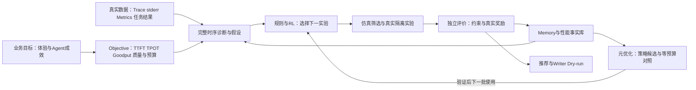
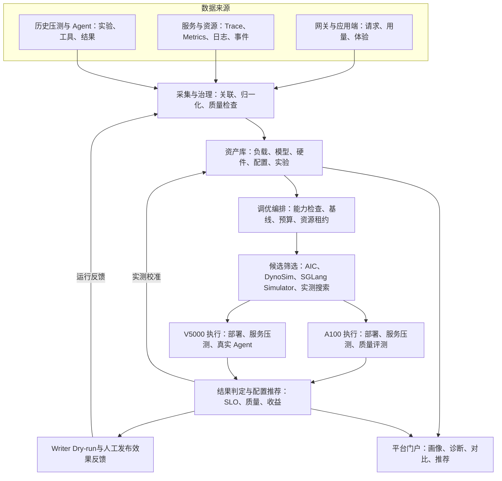
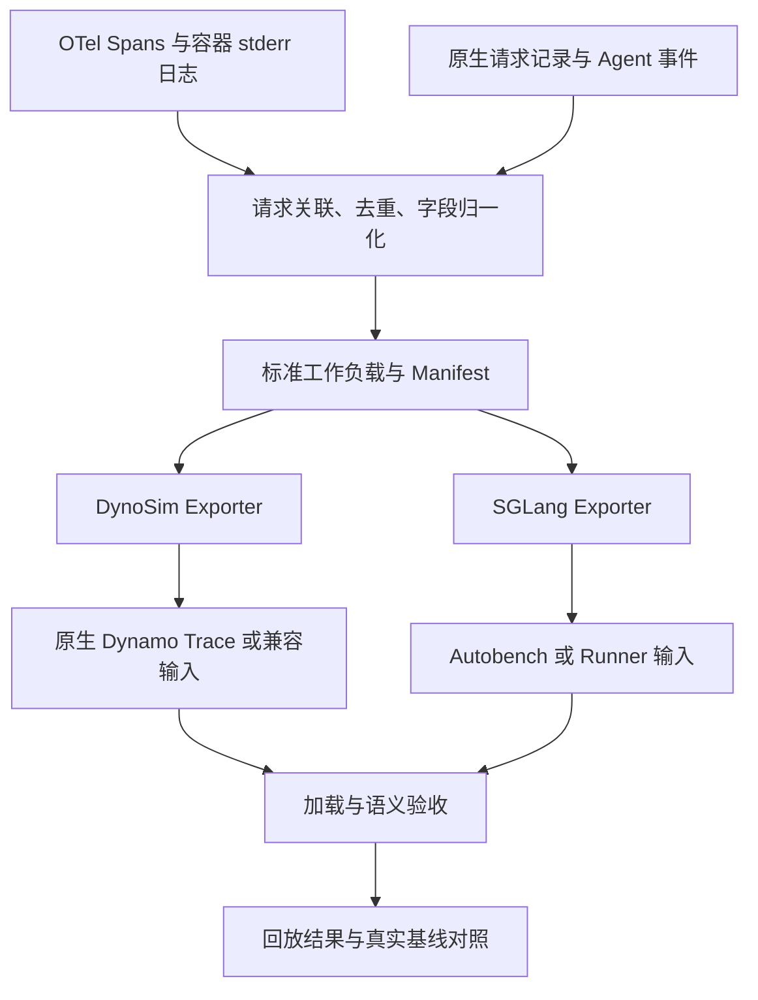
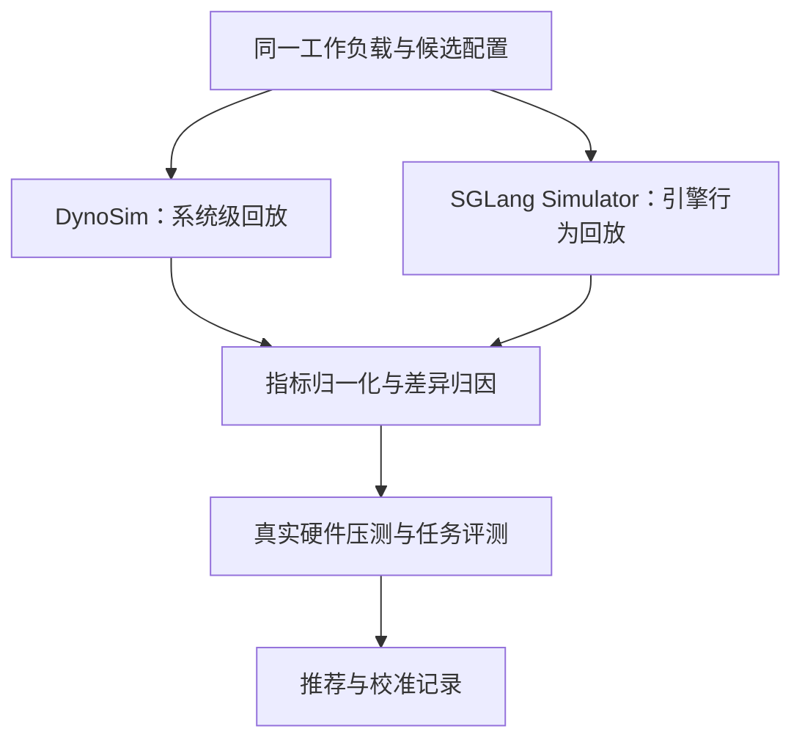
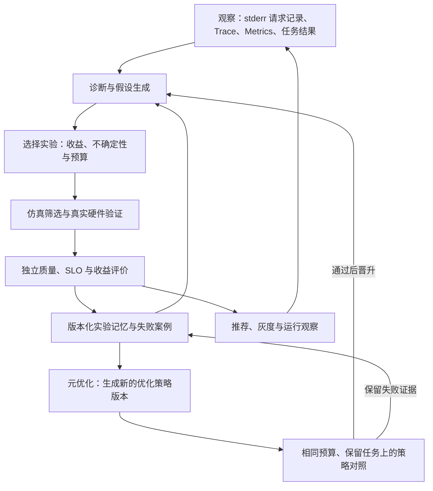
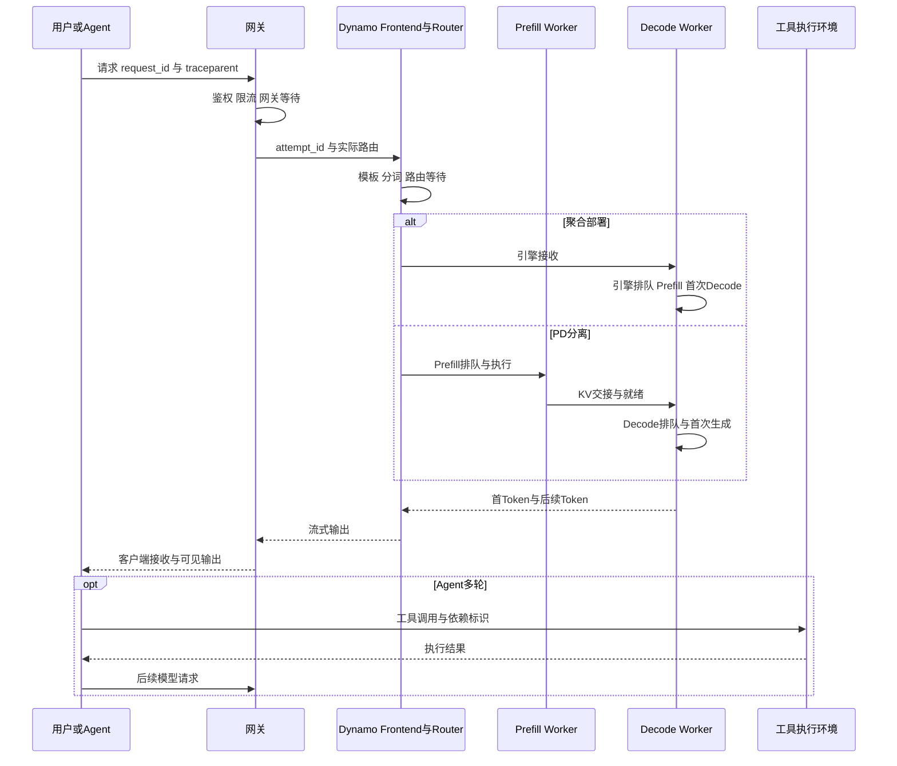
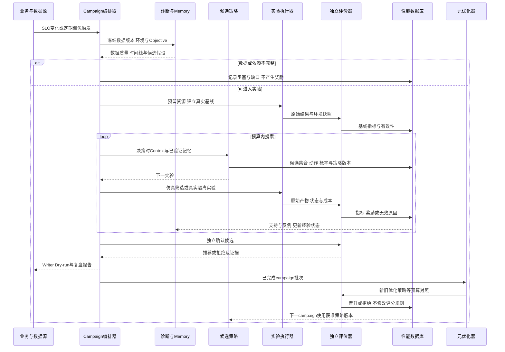
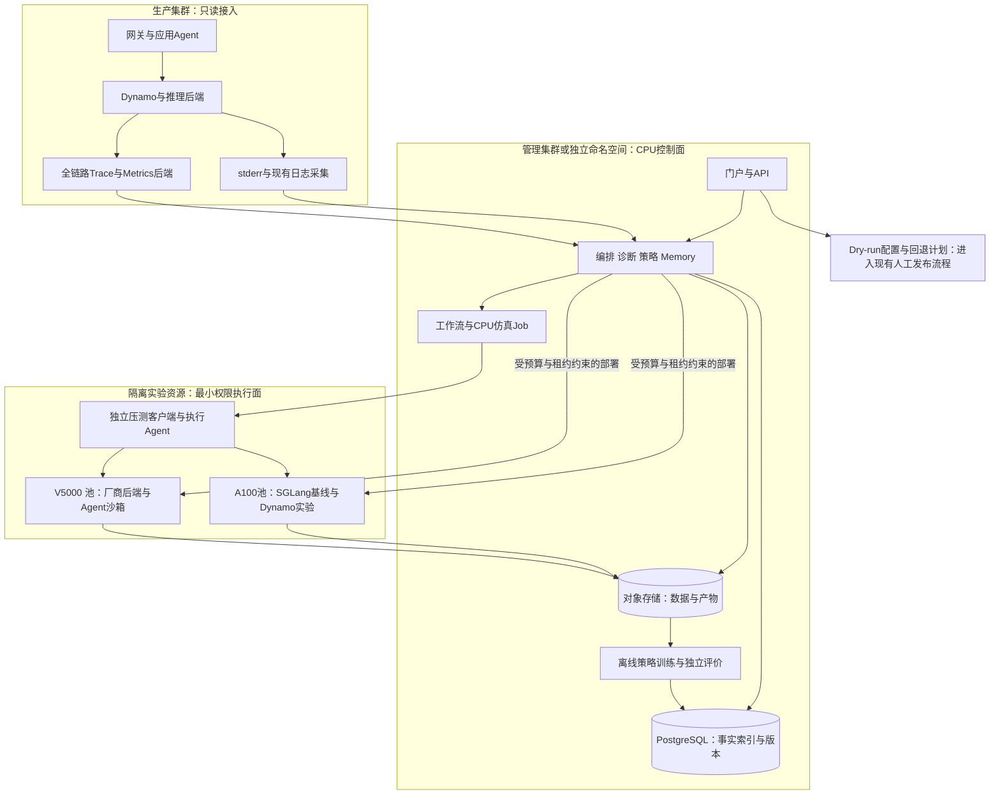

# 异构算力模型服务持续自我改进平台设计与实施方案

版本：V0.4 讨论稿
编制日期：2026 年 11 月 4 日
更新日期：2026 年 11 月 13 日
适用对象：实验室模型服务平台、推理性能、数据评测、基础设施及业务团队

立项表达见 [智能调优与持续自我改进 Issue 提案稿](model-serving-self-improvement-issue-draft.md)。该提案参照 NanHuInsight Issue 1540，将首期发布能力收敛为 Writer Dry-run，真实实验在隔离资源执行；本文所述自动生产灰度、回退和策略晋升作为后续目标，相关工作包按阶段重新冻结。

本次修订细化 Data-Driven RL、Goodput、元优化 Loop RSI、Memory 与性能数据库，补充整体业务架构、部署架构和完整诊断时序。全链路 Trace、Dynamo 上线及 Replay、SGLang 单实例优化作为外部依赖管理。日志仍走 stderr 与现有容器采集；首期生产 Writer 为 Dry-run。沿用原文件路径。

建设面向交互体验与长程 Agent 任务的异构算力模型服务持续自我改进平台：既改进服务配置，也通过可复现实验改进候选生成、实验选择和预测校准策略。首期以 A100 上的 021SFM-Thinking（236B）、021SFM-Instruct（236B），以及 V5000 上的 DeepSeek-V4.1-Flash 三个组合验证完整闭环：真实业务数据形成版本化工作负载，通过性能估算与仿真减少候选，再由真实硬件和业务评测确定可发布配置。

本版完整范围从可复现调优 L0 扩展到策略自我改进 L1。工程基准估算为 138–217 人日，含 20% 缓冲约 166–261 人日，在约四人当量和依赖就绪条件下建议 18–24 周分阶段交付。第 12 节是既有 L0 工作包，第 20 节是本版合计入口。V5000 底层适配、通用多步 RL、模拟器共享时钟深度集成、模型权重训练及自动生产发布不在此估算内。

## 1 建设目标与范围

平台需要回答：指定模型、硬件和业务目标应采用什么配置；当前配置能承载多少业务量、瓶颈在哪里；优化是否真实改善业务结果，以及如何发布和回退。

| 编号 | 硬件与模型 | 业务目标 | 首期成果 |
|---|---|---|---|
| A1 | A100＋021SFM-Thinking（236B），准确版本待确认 | 推理交互体验 | 延迟达标的配置、容量曲线和质量报告 |
| A2 | A100＋021SFM-Instruct（236B），准确版本待确认 | 对话交互体验 | TTFT、TPOT 达标的配置和稳定承载能力 |
| B1 | V5000＋DeepSeek-V4.1-Flash，部署规格及模型版本待确认 | Coding 与 Agentic 长程任务 | 可运行服务、真实任务评测和优化配置 |

远期覆盖至少三类加速卡、五个模型、三类场景，形成至少 45 个基础评估单元。首期只验收上表三个组合，离线蒸馏、第三类卡及更多模型后续扩展。

首期以服务配置调优为主。模型替换、精度变化和 Agent 策略变化分别建立实验组并增加质量验证；混合卡型构成单个并行推理实例不纳入首期。默认单个部署使用同类加速卡，平台在不同资源池之间选址。

## 2 设计原则与业务指标

以真实业务数据驱动实验，以真实硬件和任务结果决定发布。预测能力缺失时允许进入有预算的实测搜索；数据库没有数据不代表部署不可行。每项推荐都必须关联版本、负载、环境、原始结果和适用范围。

| 场景 | 优化目标 | 约束与辅助指标 |
|---|---|---|
| A100 在线体验 | 固定资源上最大化可持续请求率 | p95 TTFT、p95 TPOT、成功率和质量达标；报告 p99、逐 Token 停顿及联合达标率 |
| V5000 Coding 与 Agentic | 提高预算内任务成功率，降低时间与资源消耗 | 测试通过率、超时率、完成时间、全部尝试卡时除以成功任务数 |
| 后续离线蒸馏 | 提高合格产出吞吐 | 合格样本每小时、有效输出 Token 每秒、完整性与质量 |

TTFT 必须声明测量位置和首 Token 类型：网关首响应、客户端首 Token、用户可见内容、021SFM-Thinking 首个最终答案分别记录。TPOT 通常按单请求首末输出 Token 间隔除以输出 Token 数减一计算；输出不足两个 Token 时标记不适用。逐 Token 间隔尾部另行统计，避免平均值掩盖停顿。

021SFM-Thinking 与 021SFM-Instruct 分别冻结负载、质量门槛和采样条件。推理预算变化作为独立变量，不通过减少推理或输出长度制造性能收益。不同 tokenizer 的 Token 吞吐不能直接作为跨模型业务效率排名。

Agent 同时记录成功任务耗时和失败、超时比例；所有尝试的资源消耗均计入成本。质量阈值、SLO 和收益目标在基线阶段由业务与平台团队共同冻结。

## 3 整体架构

### 3.1 整体业务架构



执行Loop优化配置，知识Loop积累证据，元优化Loop优化实验决策。业务指标和评分由独立评价器维护，策略生成器不能改写门槛。部署边界见第19节，两类完整时序见第17节，数据与RL契约见第15–16节。

### 3.2 平台数据与执行架构

控制面统一管理数据、任务、预算和结果；执行面通过硬件与后端适配器部署和评测。采集、存储和监控优先复用实验室现有设施。



推理服务与评测客户端分别部署，避免客户端成为瓶颈。不同实验仅在服务设备、端点及关键共享资源互不干扰时并行执行。

## 4 前置工作与数据底座

| 数据域 | 首期内容 | 平台产物 |
|---|---|---|
| 网关与应用 | 到达时间、项目、场景、模型、输入输出长度、usage、重试、取消、用户端时间 | 业务画像与容量需求 |
| 服务组件 | 排队、调度、Prefill、Decode、KV 传输、缓存、错误 | 请求诊断与性能瓶颈 |
| 硬件与集群 | 卡型、显存、拓扑、CPU、网络、设备错误、资源分配 | 资源目录与环境快照 |
| 配置及事件 | 权重、tokenizer、镜像、后端、驱动、生效参数、发布、扩缩容、重启 | 配置谱系及变更时间线 |
| 历史压测 | 原始结果、环境、负载、预热、缓存、错误、客户端配置 | 分级实验目录和基线 |
| Agent | 任务、会话、调用依赖、工具、仓库快照、测试判定和总消耗 | 任务评测集与执行轨迹 |
| 校准 | 预测值、实测值、预测器与数据库版本、支持范围 | 预测可信度记录 |

### 4.1 统一关联与统计口径

业务使用 project_id、scenario_id、task_id、session_id；请求使用 request_id、attempt_id、trace_id；环境使用 deployment_id、config_hash、model_revision、image_digest；实验使用 experiment_id、run_id、candidate_id、dataset_version。

一次业务请求可能对应多次后端尝试。业务成功率按请求统计，资源消耗按所有尝试累计。输入、输出、缓存、reasoning Token 保留原始字段及归一化规则，避免重复相加；缺失 usage 标记未知而非零。拒绝请求也进入请求总量，不能只用用量日志计算成功率。[LiteLLM 请求与用量统计参考](https://docs.litellm.ai/docs/proxy/endpoint_activity)

高基数标识保存于 Trace 和明细表，不全部作为 Metrics 标签。分位数从可合并分布或原始记录计算，不平均不同实例的 p95。[Prometheus 埋点实践](https://prometheus.io/docs/practices/instrumentation/)

### 4.2 采集与质量控制

- 完整记录请求计数、错误计数和可获得的用量，定期对账。
- 生产 Trace 按策略采样，保留采样配置；慢请求偏置样本不直接用于总体分位数。
- 实验请求在预算允许时完整记录，底层 profiling 和详细 Token 时间序列按需开启。
- 跨节点校时，进程内耗时采用单调时钟；检查时间偏移、关联缺失、重复、延迟和丢失。
- 采集系统提供自身队列、失败、丢弃、存储增长及开销监控。
- 原始正文与元数据分开保存，执行访问控制、脱敏、保留和删除规则；禁止采集认证凭据。
- 明确可观测能力：直接测量、推导、不可用。V5000 缺失指标保持未知，不以零代替。

[OpenTelemetry 采样说明](https://opentelemetry.io/docs/concepts/sampling/)提供采样机制参考。A100 可接入 [DCGM Exporter](https://docs.nvidia.com/datacenter/dcgm/latest/reference/dcgm-exporter-metrics.html)，V5000 使用实际可用的厂商采集器并建立字段映射。

### 4.3 历史数据与工作负载加工

历史压测分为 A 级可复现、B 级部分可比、C 级仅供参考。A 级需具备环境、负载、配置和原始结果；B/C 级不得直接进入自动排名或高置信校准。

真实数据按模型、场景和业务周期分组，重建会话与依赖，再按长度、突发、缓存复用等特征分层抽样。数据集保留到达过程、输入输出长度、前缀关系、工具等待和请求依赖，不随机打散 Agent 链路。脱敏或重新分词后复核负载分布变化。

分别维护搜索集、校准集和独立验收集。工作负载包至少包括数据文件、版本、来源时间窗、采样规则、长度与到达分布、依赖结构、校验摘要和可用回放方式。

### 4.4 OTel 数据到 Replay 的输入契约

普通 OTel Span 与 Dynamo Request Trace 是不同数据。本项目将运行日志和 `dynamo.request.trace.v1` 请求记录直接输出到 stderr，由现有容器日志系统采集，不通过 OTel Collector 采集日志。分布式 Trace 的采集链路独立配置。Dynamo 虽提供将请求记录映射成 OTLP LogRecord 的 otel sink，本项目不启用该 sink。部署前按实际镜像版本核实能力，不能假设历史 1.4.1 镜像具有当前源码全部功能。[Request Trace Reference](../../docs/fern/pages/reference/observability/request-traces.mdx)

| 已有数据 | 回放能力 | 缺口处理 |
|---|---|---|
| HTTP Span、状态、耗时 | 请求时序分析 | 不能从耗时可靠推导 Token 长度 |
| 到达时间与输入输出长度 | 基础负载形状回放 | 标记缓存关系和内容缺失 |
| Token IDs 或可靠前缀关系 | 缓存相关回放 | 对齐模板、块大小与容量 |
| 会话、工具事件和明确依赖 | Agent 依赖回放 | 验证目标 Runner 支持范围 |
| 请求内容与任务执行环境 | 真实业务评测 | 固定工具、任务及质量判定 |

新增采集字段包括：回放边界的到达时间、请求与尝试标识、实际模型及 tokenizer 版本、模板处理后的输入长度、实际输出长度、输出上限、结束原因、输入 Token 或前缀元数据、会话依赖与工具等待。服务实际输入可能包含系统提示、工具定义和特殊 Token，不能仅对网关消息文本分词替代。021SFM-Thinking 输出记录需声明 reasoning 是否已包含在总量中。

统一使用平台中间对象 `ReplayRequest`，以下是内部字段设计，不是任一上游工具的原生 schema：

```text
identity: request_id, attempt_id, trace_id, model_revision, tokenizer_revision
arrival: relative_time_ns, capture_boundary
input: token_count, token_ids_ref, prefix_blocks_ref, block_size
output: actual_token_count, requested_limit, finish_reason
dependency: task_id, session_id, predecessor_ids, tool_wait_ms
provenance: source_record_ids, config_hash, sampling_policy, missing_fields
```

数据集 Manifest 保存 schema_version、来源窗口、过滤和采样规则、原始与有效请求数、单位、版本、回放能力、预热策略和导出校验摘要。内容或 Token IDs 通过受控产物引用保存，不强制写入每条 Span。

### 4.5 数据处理链路与双导出适配



DynoSim 优先从容器日志中提取已有原生记录，先解开 CRI 等外层封装并处理分段，再按 schema/event_type 筛选，恢复 JSONL/JSONL.GZ。普通运行日志不作为回放记录，截断或无法重组的记录进入隔离及缺失报告。关键字段为 `request_received_ms`、`output_tokens`、`replay.input_length`、`replay.trace_block_size` 和 `replay.input_sequence_hashes`，到达时间不取 `event_time_unix_ms` 的结束事件时间。记录去重后检查分片块大小和 Agent 上下文一致性；当前加载器拒绝混合会话感知与普通请求的集合。哈希可能超过 JavaScript 安全整数范围，必须无损读写，不能经过浮点转换。

只有普通 OTel 数据时，经中间对象导出目标版本支持的 Mooncake 等格式。没有前缀信息的请求只能进入限定能力的回放；不得将 trace_id、session_id 或普通文本哈希伪装成 Dynamo 的 sequence-aware rolling hash。[DynoSim 架构与加载行为](../../docs/fern/pages/developer-guide/knowledge-base/concepts/simulation/dynosim-architecture.md)

SGLang 指定版本的 Autobench 示例为 `{"prompt":[1,2,3],"prompt_len":3,"output_len":1,"timestamp":200}`，timestamp 单位为毫秒。导出器转换时间单位并校验 Prompt 表示与长度。有真实 Token 则保留；有正文则以相同模板和 tokenizer 重建；只有长度时可以生成合成序列，但不声称恢复真实缓存行为。仅有前缀哈希无法恢复原始 Token，可按共享关系生成模拟序列，但须额外验证适用性。[SGLang 输入格式](https://github.com/sgl-project/sglang/blob/3f5b1bec8e00115bc8439b5b9a9da902822d2f82/tools/sglang-simulator/README.md)

### 4.6 Agent 依赖与回放时间语义

OTel 父子 Span 不等于业务依赖。Agent 需要 task/session 标识、前置请求、工具开始结束、并行分支及汇合信息；必要时关联 Span Links 和跨 Trace 的业务记录。

| 模式 | 时间驱动方式 | 适用问题 |
|---|---|---|
| 固定到达回放 | 按记录的相对到达时间发起 | 相同外部流量下的服务容量 |
| 依赖感知回放 | 根据前置完成、工具等待与显式释放约束决定可执行时间 | 服务变化如何影响多轮任务耗时 |
| 真实 Agent | 实际模型决策和工具执行产生后续请求 | 任务成功率与端到端效能 |

对于模型 A、工具、模型 B 的串行链路，B 不得早于回放中 A 完成及对应工具等待结束。是否保留原始时间为额外下限由 workload 的调度策略声明；不能同时重复计入原始模型耗时和工具等待。工具等待在性能回放中可固定，真实任务评测则必须重新执行。

DynoSim 已有 Agent 会话重建路径，接入时核对支持结构；SGLang 普通 timestamped 输入不能默认表达依赖，需资格测试。首期适配器对不支持的依赖图拒绝执行或转交支持的路径，不能静默打散。通用多分支 Agent 驱动器属于后续扩展。

### 4.7 回放质量与校准数据分离

| 风险 | 处理要求 |
|---|---|
| 采样导致流量缺失 | 优先完整时间窗口；统计重构标记为合成负载，不能复制请求冒充原始流量 |
| 多层 Span 重复计数 | 选定回放边界，每次尝试只产生一条负载记录 |
| 取消、错误及 usage 缺失 | 显式分类；目标不支持时报告过滤数量、占比和影响 |
| 窗口切断缓存或依赖 | 使用预热与依赖上下文，区分预热区和测量区 |
| 模型、模板或 tokenizer 变化 | 由原始内容重新构造，旧 Token 与哈希不可直接迁移 |
| 原路由决策固化 | 策略对比时重新路由，原决策仅作对照 |
| 原始输出长度固定 | 标记为性能回放，不能据此证明输出质量 |
| 时钟与精度问题 | 校验偏移、单位和整数精度，保留转换误差及处理规则 |

工作负载描述请求何时到达及其形状，预测器数据库描述 batch/forward 执行成本。两类资产分开存储和版本化。普通请求 Span 耗时含排队和网络，不能作为 forward 时间或 SGLang `replay` predictor 的 batch 时间表。需要另行采集 batch 组成和执行测量用于训练与校准。

## 5 核心模块与接口

| 模块 | 实现职责 | 首期交付 |
|---|---|---|
| 资源与模型注册表 | 硬件、模型、后端、版本、能力声明 | 管理 API 与集群同步 |
| 采集与治理 | 关联、归一化、去重、质量、内容管理 | 采集适配器和质量看板 |
| 工作负载中心 | OTel 提取、请求重建、分层采样、版本化 | ReplayRequest、Manifest、双 Replay 导出器 |
| 实验中心 | 基线、候选、原始产物、指标、可比性 | 实验记录与对比 API |
| 调优编排器 | 状态、超时、重试、预算、取消、恢复 | 工作流与资源租约 |
| 预测适配器 | 合法性检查、估算、仿真、排序、差异分析 | AIC、DynoSim、SGLang Simulator 及实测搜索接口 |
| 执行适配器 | 部署、健康、配置生效、测试、清理 | A100 与 V5000 独立实现 |
| 业务评价器 | SLO、质量、容量、成功率、消耗 | 服务和 Agent 评价规则 |
| 配置发布中心 | 推荐、适用范围、灰度、回退 | 对接现有发布系统 |
| 平台门户 | 画像、诊断、实验、推荐与证据 | 五类核心页面 |

建议公共对象包括 ExperimentSpec、CandidateSpec、RunRecord、EvaluationResult、Recipe。对象具有 schema_version；引用不可变版本与校验摘要，不依赖可变 latest 标签。

工作负载接口增加 `extract`、`normalize`、`validate_workload`、`export_dynosim`、`export_sglang` 和 `compare_replay`。每次导出固定源数据摘要、转换器版本、目标 schema、过滤原因及能力声明；处理成功不等于数据达到回放准入条件。

适配器接口包括 capabilities、validate、estimate、render、deploy、health_check、benchmark、collect 和 cleanup。允许不实现 estimate，但必须声明能力。部署入口不以是否使用 Dynamo 为前提；DynamoGraphDeployment 与厂商部署模板由对应适配器生成。

建议平台 API 覆盖注册表查询、数据集发布、实验创建与取消、实验状态与结果、候选比较、配置推荐与发布。每次实际执行使用独立 run_id，幂等重试不能覆盖已有原始结果。

技术选型优先复用既有任务系统、监控和日志链路。关系数据库保存状态与索引，对象存储保存原始产物和数据集；请求明细量超过现有数据库能力后再引入专用分析存储。首期不要求新建完整监控产品。

## 6 AIC 和仿真的使用方式

| 能力 | 定位 | 决策边界 |
|---|---|---|
| AIC / AIConfigurator | 性能、显存和配置搜索 | 确认硬件、模型、后端及数据覆盖 |
| AISimulate | 配置搜索与请求回放等能力 | 按版本核实支持的后端、拓扑和模式 |
| DynoSim | 组合引擎模型、多实例、路由、PD 和 Planner 回放 | 由 AISimulate 相关入口驱动，能力以部署版本为准 |
| SGLang Simulator | 分析 SGLang 调度与缓存机制 | 仅作为适合问题的专用分支 |
| AIPerf | 真实服务负载与性能测量 | 不代替模型或任务质量判定 |
| Agent 评价器 | 真实工具执行和任务结果 | 固定任务、环境与预算 |
| Dynamo Planner | 运行期资源调整 | 在已验证边界内运行，策略单独评测 |

AIC 与 AISimulate 存在演进和迁移关系。适配器固定镜像、依赖、性能数据库和接口版本，不假设不同代际可以直接混用。[AISimulate 官方仓库](https://github.com/ai-dynamo/aisimulate)

SGLang Simulator 不作为全部候选的必经阶段；目标版本的并行、overlap 等限制应进入能力声明。共享同一预测来源的两个工具结果一致，不构成独立准确性验证。[指定版本 SGLang Simulator](https://github.com/sgl-project/sglang/blob/3f5b1bec8e00115bc8439b5b9a9da902822d2f82/tools/sglang-simulator/README.md)

校准记录同时检查数值误差、候选排序和优胜候选是否被遗漏。筛选时保留预测优胜、结构差异和高不确定性候选。端到端历史压测只能支持其覆盖范围内的校准，不能直接替代完整算子数据库。

### 6.1 两种模拟器的职责与首期协作

DynoSim 的 Mocker 核心自行维护调度、KV 分配、前缀复用及请求推进，其 SGLang 模式不等于调用社区 SGLang Simulator。后者复用对应 SGLang 版本的调度与缓存实现，并以预测执行替代模型计算。[DynoSim Simulation Model](../../docs/fern/pages/cli/operations/simulation-with-dynosim/simulation-model.md)

首期采用统一负载、独立仿真、差异分析、真实验证的协作方式：DynoSim 研究实例、路由、PD 与 Planner；SGLang Simulator 在后端匹配时研究批处理和缓存。二者存在能力交集，不能强制串联全部实验，也不能把各自端到端延迟相加。



对比前统一到达过程、输入输出、前缀关系、缓存初态、容量、目标并行配置和计时边界。两边能力不同的实验标记不可直接比较。预测分歧是安排实测的依据，不以两个模型相互认同替代真实证据。

SGLang `OFFLINE` 使用逻辑时钟，比较时读取服务端模拟指标；`BLOCKING` 按预测时间等待，但实际进程开销仍会影响墙钟测量。目标并行度用于模型预测，不等于启动真实并行 Worker。其 KV 容量需要对齐实际服务 `max_total_tokens`。[指定版本执行约束](https://github.com/sgl-project/sglang/blob/3f5b1bec8e00115bc8439b5b9a9da902822d2f82/tools/sglang-simulator/README.md)

### 6.2 深度集成作为独立研发项

未来可研究以 SGLang Simulator 替换 DynoSim 内部引擎模型，由 DynoSim 负责系统协调，SGLang Simulator 唯一拥有引擎队列及缓存状态。这是拟议集成，不是已有即插即用能力。

| 集成契约 | 需要解决的问题 |
|---|---|
| 统一时钟 | 获取下一事件、推进时间、跨实例同步 |
| 请求生命周期 | 提交、取消、首 Token、后续 Token、完成 |
| 状态所有权 | 排队、缓存、执行时间各由单一组件负责 |
| 路由反馈 | KV 事件、负载和排队状态映射 |
| PD 交接 | Prefill 完成、KV 就绪、传输与 Decode 接收 |
| 多实例与 Planner | 状态隔离、扩缩容、启动、排空 |

普通 HTTP 接口无法自动统一两种逻辑时钟。服务协议接通只证明接口可用，不证明离线仿真时序正确。研发顺序应为单实例聚合服务、多实例路由、最后 PD 与 Planner，每阶段分别与真实运行及现有模型验证。

### 6.3 两条硬件路线的适用范围

A100 路线在实际后端为 SGLang 且版本、模型覆盖通过检查时启用第二条仿真分支；其他后端不强制使用。V5000 优先真实基线和局部性能建模，更换延迟预测器不自动解决厂商调度、缓存和通信语义差异。双模拟器协作不能替代目标硬件资格检查。

## 7 A100 交互体验路线

021SFM-Thinking 和 021SFM-Instruct 分别建立负载、质量基线和配置推荐。021SFM-Thinking 重点覆盖长输出、长上下文及长短请求竞争；021SFM-Instruct 重点覆盖多轮、前缀复用、短请求和突发。

实施顺序为：确认可运行精度与并行结构，建立真实基线，生成候选，估算与仿真筛选，A100 实测，质量与 SLO 判定，独立确认及发布。

参数搜索依次覆盖：

1. 卡数、并行方式、实例数等部署结构。
2. 批处理 Token 预算、最大并发、chunked prefill、KV 配额、前缀缓存。
3. 基础配置稳定后再评估 PD 分离、路由和 Planner 策略。

236B 参数量不足以确定卡数，应根据权重精度、模型结构、KV 缓存、上下文和互联评估；MoE 激活参数不等于权重显存占用。

每个模型交付部署配置与备选、请求率—TTFT—TPOT 曲线、SLO 下稳定请求率、正常/突发/长上下文范围、质量结果和收益证据。[AIPerf 原始结果与汇总导出](https://github.com/ai-dynamo/aiperf/blob/main/docs/tutorials/working-with-profile-exports.md)作为实验产物参考。

## 8 V5000 Coding 与 Agentic 路线

第一阶段执行运行资格检查，确认指定卡型、后端、权重与精度能够加载并正确输出，验证流式、长上下文、停止条件、reasoning 字段、工具调用模板、多卡稳定性及监控。

V5000 路线需要核实 FastDeploy 或厂商后端对目标硬件及模型的具体支持版本，并取得实际运行证据，不以通用硬件支持列表代替适配验证。[FastDeploy 官方仓库](https://github.com/PaddlePaddle/FastDeploy)；[DeepSeek-V4.1-Flash 模型仓库](https://huggingface.co/deepseek-ai/DeepSeek-V4.1-Flash)

第二阶段建设固定 Agent、任务集、仓库快照、工具链和测试判定的执行环境。保存最终代码产物、测试结果、轮数、重试、上下文增长和终止原因，拆分模型等待、工具执行和环境等待。

第三阶段进行服务配置调优。缺少可靠预测时，采用有预算的实测搜索，逐步建立局部性能模型。不能以 A100 数据预测 V5000，也不能默认其他后端调度仿真在目标后端成立。

保留固定 Trace 回放和真实 Agent 执行两条路径。前者用于快速比较服务性能，后者决定任务收益；Trace 回放不重新执行工具或模型决策。[Dynamo Agent Simulation](https://github.com/ai-dynamo/dynamo/blob/main/docs/fern/pages/use-cases/agents/agent-simulation.mdx)

首期固定 Agent 策略，服务调优稳定后再单独评估压缩、重试和子 Agent 并发。真实任务执行使用隔离环境与明确的工具权限。数据集、实验、Trace、评分的展示组织可参考 [Langfuse](https://langfuse.com/docs/evaluation/get-started/offline)，实际执行和测试判定由本平台负责。

## 9 调优流程与运行控制

| 阶段 | 动作 | 通过条件 |
|---|---|---|
| 输入检查 | 版本、负载、目标、硬件与预算校验 | 输入完整，支持能力明确 |
| 基线建立 | 部署、健康、质量与性能实测 | 基线有效 |
| 候选生成 | 允许范围内生成配置变化 | 参数合法、资源可行 |
| 估算仿真 | 预测、回放、排序 | 有结果和范围，或明确跳过理由 |
| 真实验证 | 资源预留、部署、压测、业务评测 | 原始数据完整 |
| 结果判定 | 审计、质量、SLO、可比性、收益 | 满足门槛且收益具有证据 |
| 独立确认 | 保留负载、配对复测 | 结果可重复 |
| 推荐发布 | 配置库、灰度、监控和回退 | 符合发布策略 |

状态机包含待执行、校验中、建立基线、生成候选、仿真、真实实验、分析、推荐、发布及完成。失败细分为基础设施失败、配置不可行、质量不达标、数据无效和预算耗尽；另有取消状态。跳过预测保留原因，不能伪造仿真成功。

首期使用规则约束、有限搜索和预测排序。临近测量噪声的收益采用配对复测，最终候选独立确认。明确不具收益时可结束任务并输出证据，不强制产生所谓最佳改进。

资源租约按硬件与拓扑申请，多节点部署联合预留；启动、加载、预热、等待、测量、重试和释放均计入预算。取消或失败触发清理，保留产物。停止条件包括预算耗尽、达到目标、连续有效候选无收益或不可自动恢复依赖。

配置推荐通过确定性规则审核。AI 可辅助诊断和提出候选，不绕过质量与发布门槛。

## 10 平台展示与发布机制

| 页面 | 使用者可以完成的工作 |
|---|---|
| 业务需求总览 | 查询调用量、Token、峰值、分布与 SLO |
| 请求与任务诊断 | 从异常请求或任务定位 Trace、日志、资源和变更 |
| 工作负载中心 | 选择采集窗口，查看字段缺口、采样与过滤，发布数据集和双格式回放包 |
| 实验与调优中心 | 设置目标和预算、运行实验、比较双 Replay 与实测、定位差异 |
| 推荐配置中心 | 查看适用范围、预测/实测、证据、发布与回退 |

操作流程为选择模型场景、资源池和负载版本，设置目标预算，执行调优，审查结果，按策略发布。

配置键包含硬件及拓扑、模型版本、后端版本、场景与负载范围。每项推荐保存有效配置、实测证据、已知限制和回退版本，不维护跨所有场景的单一冠军。

灰度对比需要检查流量和资源可比性；单纯发布前后指标变化不能直接作为因果收益。业务 SLO、错误或质量异常触发回退。模型、镜像、驱动、硬件、负载分布及质量规则变化触发重新验证，设置冷却与预算限制，防止反复触发。

## 11 验收标准与交付清单

| 维度 | 首期验收要求 |
|---|---|
| 数据关联 | 请求关联部署和尝试；Agent 关联调用、工具与结果 |
| 数据质量 | 缺失、采样、延迟和丢失可见；请求与用量可对账 |
| Replay 数据 | 原始、有效与过滤请求数可对账；长度、到达过程、前缀和依赖具有验证结果 |
| 双 Replay | 同一标准负载可导出并运行受支持路径；时间单位、缓存容量和指标边界一致 |
| Agent Replay | 串行请求不越过前置完成及工具等待；不支持依赖显式拒绝或转交，不静默降级 |
| 可复现 | 根据实验说明重建环境、负载与运行任务 |
| 自动化 | 正常流程不依赖人工搬运结果，失败可定位恢复 |
| A100 | 两个模型各有基线、推荐或无显著收益结论、容量曲线和质量报告 |
| V5000 | 目标模型稳定运行，真实任务评测有效，形成优化证据 |
| 预测 | 误差、排序和适用范围有记录，未验证项不标已验证 |
| 资源 | 预算、取消、租约、异常清理有效 |
| 发布 | 配置可受控发布并回退 |

SLO、质量容许差异、样本规模、采集开销及收益门槛在基线里程碑冻结。未提供具体阈值前，不承诺统一提升百分比。

首期交付包括：资源与能力矩阵；采集规范与质量看板；版本化负载和 Agent 任务集；历史实验目录；调优 API 与工作流；硬件适配器；三组实验报告；推荐配置与回退配置；平台页面；部署运维手册和验收记录。

Replay 专项交付包括字段覆盖报告、标准对象与 Manifest、容器 stderr 原生请求记录提取器、普通 Span 归一化器、两种导出适配器、回放准入检查及差异报告。验证样例覆盖共享/非共享前缀、长短请求、重复事件、重试、取消、采样缺失、超过安全整数范围的哈希、跨分片记录和 Agent 串行依赖。固定输入下检查转换与重跑一致性，并对照真实基线；不将预测误差要求与格式保真检查混为一项。

## 12 L0 基础工作量与实施计划

以下为工程估算，包含开发、联调和必要测试。前提是 Kubernetes、Harbor、对象存储及基础监控可用，能够获得代表性数据，A100 后端可运行，V5000 具备目标模型可运行后端或镜像。不包含底层算子、编译器或分布式通信栈研发。

| 工作包 | 负责人角色 | 人日 |
|---|---|---|
| 需求与环境摸底 | 技术负责人、业务方 | 6–8 |
| 数据采集与关联 | 平台、数据、运维 | 12–18 |
| 数据治理与负载 | 数据评测 | 8–12 |
| 实验中心与编排 | 平台后端 | 10–15 |
| A100 调优路线 | 推理性能 | 12–18 |
| V5000 与 Agent 路线 | 推理、数据评测、厂商支持 | 10–15 |
| 门户与报表 | 前端、平台 | 8–12 |
| 发布与反馈 | 平台、运维 | 8–12 |
| 联调验收与文档 | 全体 | 6–10 |
| 原方案小计 | 基础平台工程量 | 80–120 |
| Replay 契约及双导出专项增量 | 数据评测、推理性能 | 8–12 |
| 双模拟器差异分析及回放专项验收增量 | 推理性能、数据评测 | 4–8 |
| 修订合计 | 基准工程量 | 92–140 |

增加 20% 缓冲并向上取整后约 111–168 人日，建议计划周期调整为 12–14 周。新增 12–20 人日仅覆盖原方案泛化数据加工之外的容器日志封装解析与原生请求记录提取、目标格式与精度处理、双导出一致性及差异报告，不重复计算通用采集、编排和基础页面。该估算假设可复用现成解析器及 Runner；通用 Agent 依赖驱动器或模拟器深度集成发现缺口时另行估算。

建议配置平台后端、推理性能、数据评测各一人，前端与运维合计约一人当量，另有 V5000 专项支持。自然周期还受模型适配、硬件排期、数据和串行验收影响，不等于人日简单除以人数。

| 阶段 | 周期建议 | 里程碑 |
|---|---|---|
| 环境与数据确认 | 第 1–2 周 | Trace 字段、stderr 日志接入及版本资格；V5000 运行检查 |
| 数据资产与基线 | 第 3–5 周 | 021SFM-Instruct 完整窗口、标准负载与双导出；历史导入和实测基线 |
| 自动调优闭环 | 第 6–8 周 | A100 双 Replay 对比；021SFM-Thinking 口径；Agent 依赖资格与真实评测 |
| 优化与发布联调 | 第 9–11 周 | 三组合证据、差异归因、推荐及发布能力 |
| 稳定性与验收 | 第 12–14 周 | 回放保真、复现、故障演练、文档与交付 |

V5000 若需底层适配，在前两周形成差距与专项估算；B1 排期从可运行依赖就绪后重新确认，其他平台工作可继续。

硬件消耗按各候选卡数乘以全部占用时间及重复次数计算，分别统计 A100 与 V5000 卡时。未明确计价前不将不同卡型卡时直接相加作为费用。实际功耗可用时积分估计能耗，不用设备 TDP 代替实测功耗。实验预算在基线后由加载时长、候选规模和复测需求推算。

## 13 依赖 风险与待确认事项

| 项目 | 影响 | 处理方式 |
|---|---|---|
| 021SFM 模型权重版本与精度 | 后端、显存、质量基线不确定 | 固定仓库、权重、tokenizer 与版本 |
| A100 规格与拓扑 | 并行、网络与容量不确定 | 登记显存、卡数、节点、互联、配额 |
| V5000 适配状态 | B1 无法进入性能优化 | 运行资格检查，必要时拆分专项 |
| 真实请求不完整 | 负载和缓存无法重现 | 补充元数据并明确代表性 |
| 仅有 OTel Spans | 缺少原生回放记录及 Token/前缀 | 从 stderr 提取请求记录或补充采集，按能力准入 |
| 目标 Replay 不支持依赖 | Agent 时间关系失真 | 资格测试、拒绝或转交，扩展驱动另估 |
| 两个模拟器时钟或状态混用 | 重复计时、排队与缓存失真 | 首期独立执行；深度集成单独研发 |
| 后端指标差异 | 比较口径失真 | 保留原始字段及版本化映射 |
| 预测覆盖不足 | 筛选误判 | 显式降低置信或走实测 |
| 共享资源干扰 | 实验难复现 | 隔离、快照、配对复测 |
| Agent 评测波动 | 收益判断困难 | 固定环境、预算、重复与独立验收 |

首次实施评审需要确认以下事项：

- 021SFM-Thinking、021SFM-Instruct（均为 236B）的准确模型仓库或内部权重版本及精度。
- A100 40GB/80GB、每节点卡数、节点数、网络及可用配额。
- V5000 显存、卡数、后端镜像、目标模型运行证据和厂商支持。
- 在线体验 SLO、021SFM-Thinking 首响应口径、质量基线。
- Agent 框架、代表任务、仓库快照、工具环境、判定与预算。
- 可提供的真实流量、历史压测及数据访问范围。
- 容器日志的完整性、截断和保留策略，Trace 采样策略，Dynamo 原生 Request Trace 能力及 Token/前缀、Agent 字段完整性。
- 固定 Dynamo/AISimulate、SGLang Simulator 和性能数据库版本，以及各目标 Runner 的依赖支持范围。
- 已有网关、监控、数据库、对象存储、任务编排与发布系统。
- 项目人员投入、硬件预算、责任人及里程碑日期。

后续扩展按硬件和模型注册表增加适配与能力记录，复用数据、工作负载、实验、评价和发布机制。离线蒸馏增加合格样本判定与吞吐目标，不重建整套平台。

## 14 从自动调优到持续自我改进 Loop

### 14.1 提升后的项目目标

建设一个以真实业务为评价依据、以实验为学习手段、以版本化知识为记忆的性能改进系统。在固定质量与资源约束下持续提高模型服务和 Agent 的有效产出，同时降低发现有效优化所需的实验成本。

这里按 RSI 为 Recursive Self-Improvement 理解。重复运行固定工作流只是自动化；只有系统能基于证据更新自己的优化策略，并证明新策略更有效，才具有本方案所指的有限递归自我改进特征。首期不宣称实现通用 RSI，也不宣称推理调优能够自动提升模型权重能力。

| 改进层 | 被改变对象 | 成效指标 | 范围 |
|---|---|---|---|
| 服务性能 Loop | 并行、批处理、缓存、路由、实例配置 | 延迟达标容量、质量约束下成本 | 首期主线 |
| 优化器改进 Loop | 候选生成、知识检索、实验选择、搜索空间与校准策略 | 相同预算找到更好配置，或更少卡时达到同等效果 | 首期留接口，第二阶段实现 |
| Agent 效能 Loop | 上下文、工具选择、提示策略、重试与执行流程 | 保留任务集成功率、完成时间和总消耗 | V5000 后续扩展 |
| 模型能力 Loop | 数据配方、蒸馏、微调及权重版本 | 独立质量与能力基准、训练及推理总成本 | 单独训练研发项目 |

可借鉴 Darwin Gödel Machine 的候选归档、生成新版本及外部任务评价思路；本平台首先将该思路应用于优化策略和服务配置，不直接复制其自修改代码机制。[DGM 官方介绍](https://sakana.ai/dgm/)

### 14.2 三个相互反馈的 Loop



执行 Loop 改进服务配置；知识 Loop 沉淀可迁移经验；元优化 Loop 改进执行 Loop 的决策策略。元优化以完成一批可比较实验为触发单位，避免每次请求都更新策略；运行期扩缩容与较慢的实验策略晋升分别控制。

### 14.3 新增核心能力与数据对象

| 能力 | 实现要点 |
|---|---|
| 实验记忆库 | 保存成功、失败和无收益实验；按硬件、模型、后端、负载与版本检索，附适用范围和失效条件 |
| 假设生成器 | 输出瓶颈证据、改变对象、预期机制、可证伪结果与验证计划；优先单因素或明确耦合机制 |
| 实验选择器 | 在预算内兼顾预测收益、信息增益和探索；成本包括加载、失败、占用及推理调用 |
| 策略版本库 | 记录父版本、提示模板、搜索规则、预测器、参数和全部关联实验；允许多种候选并存 |
| 独立评价服务 | 固定评价代码、质量门槛及保留任务，策略生成器不能自行改写评分规则 |
| 迁移与失效管理 | 复用相似环境的先验，但新硬件与后端必须实测；检测数据漂移后降置信或重新校准 |

增加 Hypothesis、ExperimentMemory、OptimizerPolicyVersion、PromotionDecision 对象。所有晋升绑定证据和父版本，可回退；用于探索的反馈与用于最终晋升的保留任务隔离。预测器重训不自动等于优化器改进，必须验证其实际候选选择收益。

### 14.4 如何证明优化器自身变好了

以人工规则、随机或有限网格搜索、固定版本优化器作为对照。新旧优化器在相同硬件配额、总预算和任务分布下进行多轮独立对照，分别报告冷启动和历史记忆复用条件。

- 达到指定 SLO 与质量目标所需的加速卡时、总成本和墙钟时间。
- 固定预算内找到的最佳达标容量或单位成功任务消耗，以及 Pareto 前沿。
- 有效候选比例、重复无效实验比例、预测排序错误与回退次数。
- 保留负载及未参与搜索的模型/硬件组合上的迁移表现；不以训练内成绩替代泛化。
- 关闭实验记忆或策略更新后的消融对照，用于区分自动化收益、数据积累收益和策略演进收益。

统计评估保留失败及超时，固定或记录随机种子与策略模型版本。避免对同一验收集无限试探；新增任务批次与周期性独立验收用于降低反复选择造成的偏差。不能用一次实验胜出证明持续自我改进，也不承诺每轮必然改善。

### 14.5 两条业务路线的演进示例

A100 路线：长请求导致 TTFT 尾部恶化，形成调度假设，经仿真和实测选择批处理或路由参数；结果写入实验记忆。下一批相似负载直接利用先验缩小搜索，再与固定优化器比较是否减少卡时。服务收益和搜索效率收益分别验收。

V5000 路线：任务耗时先拆分模型等待、工具执行与重试；服务配置优化在固定 Agent 下验证。后续上下文压缩或工具策略作为独立 Agent 版本实验，在真实任务中检查成功率和成本。两个变化同时发生时使用分组对照，不能将服务加速归因为模型推理能力增强。

### 14.6 分阶段交付与预算边界

L0 为第 1–13 节的可复现调优基础，首期额外交付策略版本标识、完整实验记忆和固定策略基线，为后续演进留接口，不自动生成或晋升策略代码。

L1 在 L0 验收后实现检索驱动假设、实验预算分配、优化策略版本对照和晋升。初步新增工程量为 20–35 人日，不含额外硬件实验费用；按岗位可用性估计增加约 4–6 周，详细工作包在 L0 基线完成后复核。范围限于策略配置、提示模板和候选选择逻辑，不包含任意自修改运行时、评分器或生产代码。

L2 为独立 Agent 效能演进；L3 为训练、蒸馏和权重能力演进。二者在任务集、模型适配、训练资源与质量规则明确后单独立项。首期成功标准是提供可验证的持续改进基础，L1 成功标准是在保留任务上证明优化过程本身更高效。


## 15 Data Driven RL 与 Goodput 评价

### 15.1 指标契约与目标函数

Data-Driven 表示决策使用可追溯的请求与实验事实，不能仅以日志摘要或 LLM 判断作为奖励。为每个场景固定 ObjectiveVersion，记录测量边界、TTFT/TPOT 定义、阈值、成功标准、负载、统计窗口、质量规则、单位及归一化常数。

对请求 i 定义 good_i：请求成功且完整、TTFT_i 不超过该场景阈值、TPOT_i 不超过阈值，并满足约定的其他逐请求条件。N_good 为同时满足条件的请求数。TPOT 不适用的单 Token 请求须事先规定单独分层或判定规则，不能运行后选择排除。质量只有抽样或任务级评价时，作为独立硬门槛，不虚构逐请求质量分数。

| 指标 | 口径 | 决策作用 |
|---|---|---|
| SLO Goodput | 同时达标且完成的请求数除以指定测量秒数，单位 good requests/s | 服务有效吞吐 |
| SLO attainment | N_good / N_issued，同一计数边界下失败、超时、拒绝计入分母 | 防止提高吞吐却牺牲大部分请求 |
| TTFT / TPOT | 逐请求分布及 p50/p95/p99，021SFM-Thinking 另记首答案时间 | 定位与质量约束 |
| Token Goodput | 达标请求实际输出 Token 总数除以窗口秒数，独立命名 | 辅助同模型比较，不替代请求 Goodput |
| Agent 效能 | 固定任务预算内成功率、完成时间、全部尝试卡时/成功任务数 | V5000 真实业务目标 |

离线候选比较固定到达窗口 W，以窗口内发起的请求作为 cohort，使用相同排空上限和逐请求截止时间处理尾部请求。cohort_goodput=N_good/W；尚未完成或超时记失败，不能因为候选更慢而把未完成请求从分母删除。该口径与生产窗口内完成计数、工具默认 Goodput 分开保存。开放环负载防止响应变慢时客户端自动降压掩盖排队；固定并发实验单独归类。重试按业务请求和后端尝试分别记录，避免重复计入有效请求。

AIPerf 的 Goodput 表示满足指定 SLO 的完成请求每秒；其版本、指标定义及分母需通过适配器核对，不将单请求平均 TPOT 等同于所有逐 Token ITL。平台从逐请求数据重算统一指标，并同时保留工具原值。[AIPerf Goodput](https://github.com/ai-dynamo/aiperf/blob/main/docs/tutorials/goodput.md)

### 15.2 RL 的状态 动作与奖励

首期在隔离实验中使用受约束 Contextual Bandit，选择一个经过可行性检查的候选配置并观察本轮反馈。这是单步决策的 RL 路径，不声称已完成长期状态转移的完整 MDP 训练。对连续配置先生成有限候选，由策略选择，冷启动保留规则和随机探索对照。Contextual Bandit 的上下文、动作和反馈模式可参考 [Vowpal Wabbit 官方说明](https://vowpalwabbit.org/docs/vowpal_wabbit/python/latest/tutorials/python_Contextual_bandits_and_Vowpal_Wabbit.html)。

| 对象 | 内容 |
|---|---|
| Context x | 模型与后端版本、硬件拓扑、当前配置、ISL/OSL 分布、到达与突发、前缀复用、排队和 KV 压力、剩余预算、已知实验结果 |
| Action a | 从允许集合选择下一组实验配置；首期优先批处理、并发、chunked prefill、缓存及合法并行组合 |
| Environment | 冻结工作负载和缓存初始化的模拟环境或真实隔离服务；两种结果分别标识 |
| Observation | 原始请求结果、实际资源占用、错误、Goodput、SLO、质量及成本 |
| Policy | 候选打分、探索概率、可行性掩码；部署与评分规则由独立组件执行 |
| Episode | 从基线开始，在固定目标与预算下结束的一次调优 campaign；首期逐动作学习，不把任务级反馈冒充即时标签 |

服务目标采用质量、成功率、SLO attainment 和资源上限硬约束，通过后优化 Goodput。探索评分可采用以下版本化公式示例，常数和权重需在实验前冻结：

```text
若配置明确不可行或违反质量/SLO门槛：reward = -1
若真实有效实验通过门槛：
  reward = clip(log((G + g0) / (G_ref + g0)) - lambda * C / C_budget, -1, 1)
若采集或基础设施失败导致结果无效：reward = null，记录占用成本并按独立规则重试
```

g0 为固定正参考尺度，处理基线 Goodput 为零；C 为本次实验完整成本，C_budget 为正预算。运行间负载、资源或目标不同，不直接比较归一化分数。候选 OOM 等配置相关失败与外部节点故障分开标注，后者不能误教成配置差。硬门槛独立于奖励实现，RSI 不能通过改权重绕过门槛。

Agent 奖励以任务结果为主，成功率先过门槛，再比较耗时与成本，服务 Goodput 仅作诊断特征。人工评价提供假设质量与建议可操作性的独立标签，不直接覆盖实测奖励。

### 15.3 训练数据与晋升路径

每次选择保存 policy_version、特征快照、候选全集与掩码、action_id、选择概率 propensity、随机种子、预测来源、奖励版本、run_id 和完整成本。特征只能使用决策时可见数据，后验结果不能泄漏到当时 Context。

真实实验是策略晋升的主要证据，仿真结果用于预筛或单独预训练，不与实测标签无差别合并。历史人工配置缺少选择概率时，可用于先验、监督拟合或检索，但不能据此声称 IPS 等离线策略评估无偏。离线评估需检查动作支持重叠、概率可信度和有效样本规模；仍需独立真实实验确认。

路径为固定规则基线、受控探索日志、离线策略学习与评估、隔离资源对照、新策略登记。生产仅提供只读数据，配置发布仍为 Writer Dry-run。只有后续确需跨时间扩缩容、热缓存迁移或持续资源控制，且有可靠 transition、延迟奖励和环境模型时，再立项完整多步 RL；不默认采用 PPO 等算法。

## 16 Memory 与性能记录数据库

### 16.1 事实与知识分层

性能记录数据库保存可验证事实，Memory 保存经验与推断。实测表是事实依据，向量相似度和 LLM 总结都不能直接作为性能证据。

| 层 | 主要内容 | 生命周期 |
|---|---|---|
| 原始证据 | 请求 JSONL、Trace 引用、日志片段、配置、评测输出、任务产物 | 对象存储不可变对象、摘要、权限和保留策略 |
| 性能事实 | 环境、负载、候选、run、指标、有效性、成本、质量 | 追加记录，纠错产生新 revision，保留旧引用 |
| Episodic Memory | 本轮 Context、假设、行动、结果及原因 | 关联全部实验，包含失败与无收益 |
| Semantic Memory | 适用某硬件/后端/负载的瓶颈规律和经验 | proposed、validated、stale、rejected，标注反例 |
| Procedural Memory | 经过验证的调优步骤和配置 recipe | 版本化执行条件、前置检查与回退方法 |
| Working Memory | 当前任务计划、已尝试候选、剩余预算 | 运行级短期状态，不替代长期证据 |

初期采用 PostgreSQL 保存事务实体、性能摘要、版本和检索索引，S3 兼容对象存储保存原始产物。请求级大量分析可复用现有分析库，达到容量门槛后再引入 ClickHouse；向量索引优先评估已有能力或 pgvector，作为可重建的辅助索引。监控时序仍由已有 Prometheus 类系统承担。具体数据库产品上线前通过实验室可用性确认。

### 16.2 核心表与关联

| 表或实体 | 主键及关键字段 | 约束与用途 |
|---|---|---|
| environment_snapshot | env_id；卡型、拓扑、驱动、镜像、模型与 tokenizer revision、后端版本 | 不可变快照，含实际生效参数及共享资源状态 |
| workload_version | workload_id；source_digest、时间窗、split、manifest_uri、过滤规则 | 搜索/校准/验收隔离，保留数据谱系 |
| objective_version | objective_id；指标、阈值、时间边界、质量门槛、reward_version | 由独立评价侧维护 |
| campaign | campaign_id；env/workload/objective 引用、预算、状态 | 一组可比较实验及预算账本入口 |
| hypothesis | hypothesis_id；证据、改动、机制、反证条件、作者或策略版本 | 与动作及记忆双向追溯 |
| candidate | candidate_id；config_hash、parent_id、hypothesis_id | 配置不可变；去重仅避免误重复提交，不禁止有意复测 |
| experiment_run | run_id；campaign/candidate/env/workload、seed、cache_state、attempt、validity、fidelity | 唯一运行；模拟/实测/生产观察分开标记 |
| metric_result | run_id + metric + scope + revision；数值、单位、n、窗口、区间、口径版本 | 禁止仅存 p95 截图；记录分子分母与可比系列 |
| artifact | artifact_id；run_id、URI、SHA256、大小、类型、访问级别 | 原始对象完整性与可用性检查 |
| policy_decision | decision_id；policy_version、Context 摘要、action_set、action、propensity、run_id | 支持重现选择与 Bandit 日志 |
| policy_feedback | decision_id + revision；reward、reward_version、validity、cost | 延迟反馈幂等关联，纠错保留版本 |
| memory_entry | memory_id；类型、scope、status、confidence、过期条件、父版本 | 结论可撤销，不凭摘要升级为事实 |
| memory_evidence | memory_id + evidence_id；run/指标/反例引用、关系 | 每条有效经验至少可追溯到明确证据 |
| optimizer_policy | policy_id + version；父版本、代码/提示/配置摘要、训练数据引用、状态 | candidate、evaluating、champion、retired |
| promotion_decision | promotion_id；新旧策略、evaluation_suite、证据、决策人/规则、回退版本 | 保存晋升或拒绝，不由生成器直接改状态 |

外键连接环境、负载、目标和实验；候选可跨重复 run 复用，重复 run 必须独立计费。metric_result 保留 request 与 attempt 两种 scope，防止重试重复计算 Goodput。原始样本与摘要关联后，平台可从建议追溯到逐请求结果。

### 16.3 写入 检索与失效

执行器先上传内容寻址产物并验证摘要，再提交实验完成记录；数据库事务同时写状态、指标引用和 outbox 事件。后台消费 outbox 更新分析/向量索引，使用事件 ID 去重，不宣称跨数据库天然 exactly-once。上传失败、孤立产物及迟到结果均有对账任务；超时 run 后到的结果创建补充 revision，不静默改写已训练标签。

Memory 检索先按权限、硬件、模型、后端、Objective 和负载范围做结构化过滤，再做语义召回与证据重排。输出包含适用条件、支持与反例、最近实测时间及置信信息。跨卡型仅作为待验证假设；更新模型、驱动或后端时标记潜在失效，验证通过才能恢复 validated 状态。

搜索数据可用于策略训练；保留评价数据由独立服务访问，Memory 不向候选生成器泄漏保留任务内容或答案。相同会话、任务派生样本按组划分，避免跨 split 泄漏。删除敏感原始内容时传播到派生内容及向量索引，留下不含敏感正文的失效标记；依赖被删证据的经验不再标为可复现。

## 17 工程模块与完整诊断时序

### 17.1 工程模块和职责边界

以下为待实现的逻辑模块，可按规模合并部署，不代表仓库已有同名服务。

| 模块 | 输入与输出 | 主要职责及边界 |
|---|---|---|
| telemetry-adapter | Trace、stderr、Metrics、事件 → 规范化事实 | 只读采集、关联、脱敏、缺失与时钟检查 |
| workload-builder | 规范化事实 → ReplayRequest、Manifest、双导出 | 保留时序和前缀，拒绝不支持依赖 |
| timeline-diagnoser | 请求/任务及环境 → 时间线、瓶颈假设 | 阶段分解、关键路径、证据与反证；不把相关性当根因 |
| performance-store | run 与原始产物 → 指标查询、比较系列 | 写入事务、有效性、口径、事实与预测分离 |
| memory-service | 实验与专家评价 → 有证据的记忆 | 检索、归纳、版本、反例、失效与权限 |
| candidate-policy | Context、记忆、候选空间 → 动作及概率 | 规则/Bandit 选择、约束掩码、决策日志 |
| experiment-orchestrator | 动作 → run 和资源租约 | 预算、队列、状态机、重试、取消、恢复 |
| simulation-adapter | 候选与负载 → 预测及置信范围 | AIC、DynoSim、SGLang 独立运行及归一化 |
| execution-adapter | 候选与租约 → 健康服务和产物 | A100/V5000 部署、参数生效、压测、清理 |
| evaluator | 原始结果与 Objective → Goodput、质量、奖励 | 独立评分、可比性、有效性；生成器只读结果 |
| meta-optimizer | 完整 campaign 与记忆 → 新策略版本 | 批次学习、消融、保留评价、晋升提案 |
| plan-writer / UI | 推荐与证据 → Dry-run 计划和复盘页面 | 配置差异、影响、回退、完整过程可视化；无生产写权限 |

API 至少包括创建 campaign、查询预算/时间线、导出工作负载、提交与取消 run、查询证据与 Memory、对比策略版本及生成 Dry-run。写接口带幂等键和版本检查；任务进程重启后根据租约及 run 状态恢复，不重复占用设备。

### 17.2 用户请求与任务的时序诊断



时间锚点至少记录客户端发送/接收、网关接收/转发、Frontend 接收、引擎入队/开始、Prefill 完成、KV 可用、首 Token 和末 Token。实际端点不支持的锚点标为 unknown，不用剩余时间强行归入某阶段。没有客户端埋点时仅声明网关或服务端 TTFT。

诊断流程为：检查 trace/request/attempt 关联和时钟偏移；构造请求与 Agent 依赖 DAG；对嵌套 Span 计算 self-time，重叠阶段按关键路径而非直接相加；关联同一设备与配置的指标和事件；提出可证伪假设；用控制变量实验确认。

| 现象 | 需要的证据 | 可验证假设与实验 |
|---|---|---|
| TTFT 高且引擎前等待长 | 网关、路由、引擎排队分段与到达突发 | 分别调整入口负载、批处理或实例数，避免将网关等待归咎算力 |
| Prefill 时间长 | ISL、未缓存长度、batch、卡利用及前缀 | 固定输入比较缓存、分块和并行配置 |
| TPOT 高或间歇停顿 | 首末/逐Token、Decode batch、KV压力、抢占与通信 | 排查缓存压力和并发，再做隔离配置实验 |
| PD 首响应慢 | KV就绪、传输、Decode等待、网络状态 | 区分通信与目标排队，不能只看传输总 Span |
| Agent 总耗时长 | 多轮依赖与工具耗时、重试、模型等待 | 固定 Agent 测服务收益，再独立评估工具与上下文策略 |

完整时序指覆盖已约定的路径、标出未知区间并可追溯，不意味着所有时间都能精准分配。重试、超时、取消和未完成请求纳入诊断；慢请求 Trace 的采样偏差不用于整体指标计算。

### 17.3 从诊断到实验 再到策略更新



采集故障与配置失败分别处理；结果无效仍记占用成本。已有生产发布结果作为观察反馈，经环境与负载可比性检查后才用于效果判断，不直接作为随机对照奖励。

## 18 元优化 Loop RSI 的工程实现

服务级策略 theta 在单个 campaign 中保持版本固定或采用明确声明的在线更新规则；元策略 phi 只在 campaign 批次之间更新候选生成、记忆检索、探索比例和实验预算分配。元优化的动作是“生成新的优化器版本”，不是更改用户模型权重，也不是随时修改生产服务。

```text
输入：多轮有效campaign、失败实验、专家反馈、训练任务分组、完整成本
输出：新optimizer_policy版本及与父版本的差异
不可修改：保留任务答案、评价器、SLO门槛、质量规则、资源权限
晋升依据：等预算保留任务的搜索效率与业务性能 + 稳定性检查
```

实现顺序：归档父策略及其数据；生成多个有限变更候选；在搜索任务上筛选；由独立评价器在保留任务执行等预算对照；检查失败成本和多种子结果；产生 PromotionDecision；下一批 campaign 使用获准版本。拒绝版本仍归档。相同初始条件下比较策略，不能给新策略更多 GPU 或额外记忆却将收益全归因策略算法。

三组消融分别为固定策略、固定策略加 Memory、策略加 Memory 并允许元更新。主指标为固定总预算下的最佳可行 Goodput/Agent 成效、达到同等目标所需卡时、无效实验占比；跨硬件迁移作为单列结果。不能用新策略自己的训练奖励决定晋升。反复查询保留集需限制频率并轮换新任务，报告结果不确定性。

RSI 的首期实现范围是可版本化策略配置、提示模板与决策逻辑的受控演进，不包含任意自修改底层运行时。无显著收益时保留旧版本；漂移触发重新验证或回退。只有证明改进了“发现优化的方法”，才标记该轮元优化成功。

## 19 部署架构与外部依赖

### 19.1 部署边界



图中管理集群是逻辑隔离边界，不要求新建物理集群。控制面 ServiceAccount 无生产写权限，实验执行器仅能操作指定命名空间和资源池；模型、镜像、数据库和对象存储凭据通过 Secret 引用，不写入实验记录。API无状态部署，worker通过租约和持久状态恢复；工作队列可优先复用现有工作流，初期无需额外引入消息集群。

运行日志和请求记录始终使用 stderr 与现有日志平台；OTel Collector 仅按既有方案承担 Trace 等独立信号，不新增日志 pipeline。原始数据分级授权，实验服务与客户端隔离，网络及存储瓶颈纳入环境快照。Harbor 提供固定 digest 镜像；资源不足时排队或停止，不借用未授权生产设备。

### 19.2 外部依赖契约和验收门槛

| 依赖 | 交付方角色与必须提供的内容 | 验收与阻塞边界 |
|---|---|---|
| 全链路 Trace | 网关、服务、Agent 与可观测团队；跨服务上下文、request/attempt/session ID、阶段锚点、采样及查询接口 | 一条请求可贯通实际组件，包含重试和终止，关联日志和配置；缺失阶段标未知。未完成时可做孤立基准，不能宣称全链路根因 |
| Dynamo 上线与 Replay | 服务平台团队；固定镜像、健康服务、stderr Request Trace、版本与回放能力矩阵、资源及发布边界 | 捕获完整窗口并成功回放；对账数量、Token、时序及前缀，校验原生schema与版本。离线工具可先独立建设，真实生产捕获与系统级验证等待上线依赖 |
| SGLang 单实例优化 | 推理团队；准确模型、可运行镜像、实际调度参数、KV容量、单实例基线、受控参数空间和测量工具 | 可重复的Goodput容量曲线、质量基线、显存/并行可行性及参数生效证据；先固定资源单实例，再扩展多实例和PD。单实例可含多张卡，不等于单GPU |
| V5000 目标模型支持 | 厂商与推理团队；硬件、镜像、工具调用、上下文与监控接口 | 目标模型运行资格通过才进入真实Agent优化；不能把SGLang已有优化结论自动迁移到厂商后端 |

依赖逐项标记 not_started、integrating、verified、blocked，并附owner、版本和证据。以上为需要交付的外部条件，不是对当前生产完成状态的断言。

### 19.3 实施先后顺序

全链路埋点与 SGLang 单实例基线可并行；数据库、Memory 接口及标准负载使用受控样本先行。SGLang 基线通过后进行同资源规则搜索，形成真实奖励数据；Dynamo 上线后接真实捕获和系统回放；Bandit 在隔离资源验证；最后做元优化等预算对照。新增多实例/PD必须以单实例基线为参照，区分引擎优化和系统协调收益。

## 20 本版工程工作量与验收

本节为 V0.4 的实施估算入口。第 12 节保留既有 L0 基础工作包，第 14 节 L1 元优化预算计入此表而非再次叠加。新工作按已有平台、具备测试资源和外部依赖就绪估算，实际按任务拆分复核。

| 工作包 | 范围与增量边界 | 人日 |
|---|---|---|
| L0基础与双Replay | 复用第12节基准，含基础数据库、调优编排与Dry-run | 92–140 |
| Data-Driven RL | Objective与Goodput复算、决策概率日志、Bandit训练和对照；不含基础压测重复建设 | 12–20 |
| Memory与性能数据库深化 | 证据关系、反馈revision、Memory生命周期、训练split与索引治理；不重复基础表和存储接入 | 8–12 |
| 时序诊断深化 | 关键路径、self-time、未知区间、假设证据面板；不含外部埋点开发 | 6–10 |
| L1元优化 | 策略候选、等预算评价、消融和晋升；沿用前版20–35估算 | 20–35 |
| 合计 | L0到L1完整范围 | 138–217 |
| 含20%缓冲 | 上界下界分别向上取整 | 166–261 |

约四人当量配置下，外部依赖就绪后建议分阶段安排约 18–24 周；这是新增功能后的计划假设，不是模型适配未完成条件下的承诺。硬件实验等待、采集补齐和厂商适配单列，实验卡时、策略模型调用和长期存储费用另预算。

| 阶段 | 主要交付与验收 |
|---|---|
| M0 依赖与数据契约 | 三项外部依赖owner、版本、缺口；Objective、数据split、资源权限确认 |
| M1 单实例与数据基础 | SGLang真实基线、Goodput复算、stderr/Trace关联、数据库与回放准入 |
| M2 可复现调优 | Dynamo Replay与双模拟器协作、隔离实验、Memory证据、诊断和Dry-run完整链路 |
| M3 Data-Driven RL | 受控探索日志、规则与Bandit等预算对照、真实奖励与无效结果分离 |
| M4 元优化 | 三组消融、保留任务策略对照、晋升/拒绝记录、下一批campaign可复现 |

验收必须覆盖：逐请求联合SLO而非独立p95相乘；窗口尾部与失败不丢计数；仿真与实测不能混用奖励；无效run成本仍入账；同一决定不会被重复更新；Memory结论可追溯并能失效；后验特征和保留答案不泄漏；不支持依赖显式拒绝；控制面不能修改生产。系统可交付“没有显著改进”的可复现结论，不通过调整评价规则制造收益。
